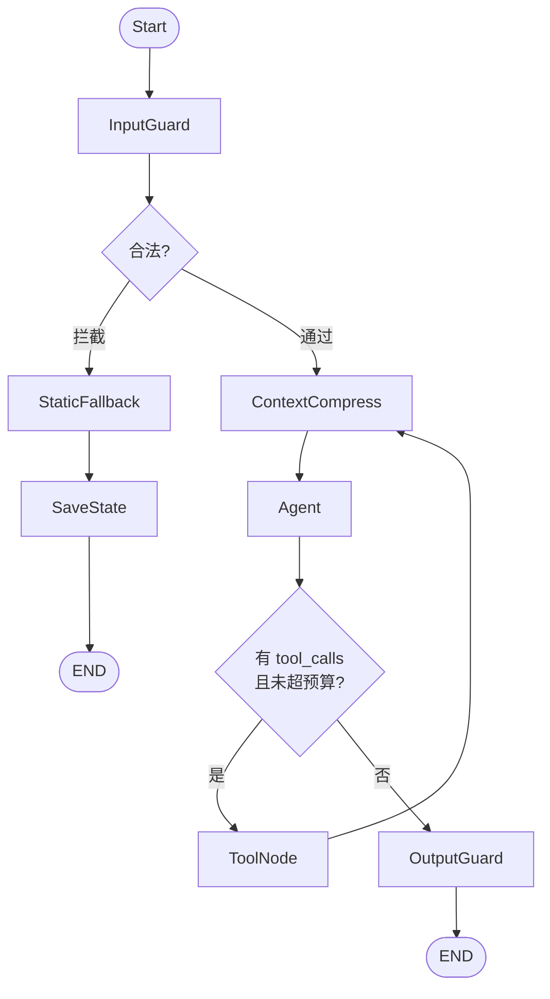
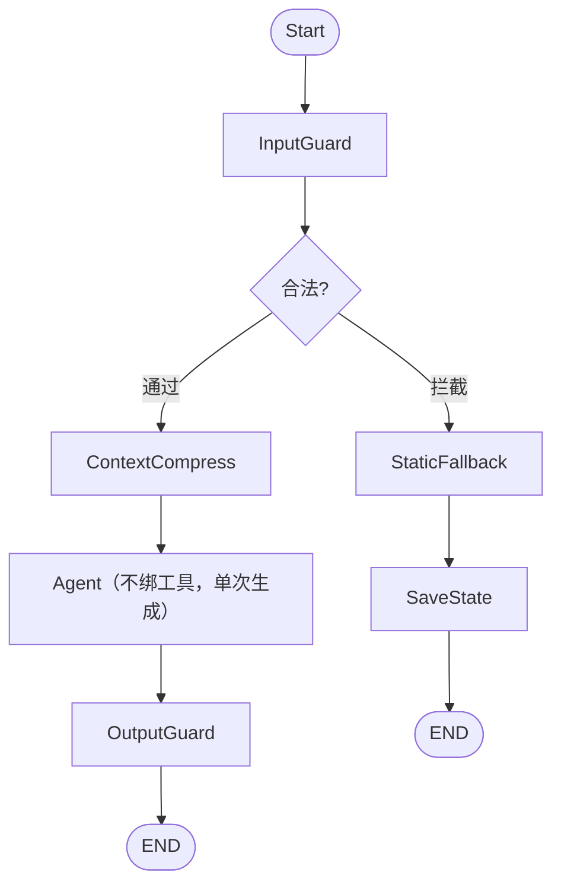

# 阶段 0 架构设计：LangGraph 长对话法律问答系统

| 项 | 内容 |
|---|---|
| 版本 | v1.1（设计定稿，未进入编码） |
| 日期 | 2026-10-26 |
| 状态 | **设计定稿**（ADR-01~06 全部关闭），可进入编码 |
| 拓扑 | **带环 Agent Loop**（`SIMPLE_MODE` 可退回流水线，见附录 B） |
| 适用范围 | 阶段 0：只读链路（RAG 检索 + 生成 + 双向护栏） |
| 硬约束 | 单机 8 GB 内存；LLM 仅允许 Qwen 小模型；禁止 KeyError |

---

## 1. 目标与非目标

### 1.1 目标

1. 用 LangGraph 把「长对话法律问答」表达为显式状态机，节点职责单一、可单独测试。
2. 任何分支（含拦截、检索未命中、模型异常）都必须留下对话痕迹，**历史不失忆**。
3. 上下文超长时按滑动窗口裁剪，**不拆散工具调用配对、不截断 System Prompt**。
4. 在 8 GB 内存下稳定运行：模型单例、懒加载、峰值 RSS 可控。
5. 全链路零 KeyError：所有读取走 `.get()`，所有字段有默认值。

### 1.2 非目标（阶段 0 明确不做）

| 不做 | 原因 |
|---|---|
| 写操作工具（合同起草、文书生成、文件写入） | 只定义节点签名与状态字段，**不接入主图** |
| 多轮工具循环（ReAct 循环） | 阶段 0 只有一次 RAG 读取，无 agentic loop |
| 人工审批（Human-in-the-loop） | 预留 `requires_approval` 字段，不接 interrupt |
| 向量库持久化与增量索引 | 阶段 0 用内存索引，启动时加载 |
| 流式输出 | 阶段 0 走 `invoke`，流式在阶段 2 评估 |
| 多用户 / 会话隔离 | 阶段 0 单会话，checkpoint 只做本地内存 |

---

## 2. Harness 思想映射

Claude Code 的 Harness 本质是「把 Agent 的不确定性关进确定的壳里」。本项目逐条映射：

| Harness 原则 | 本系统落点 |
|---|---|
| 工具面收窄，只给最小必要能力 | 阶段 0 仅 `ToolNode`（内部只有 `ReadTool`），无写权限 |
| 输入先过闸，再进模型 | `InputGuard` 是图上第一个节点，不是中间件 |
| 输出再过闸，坏内容不入历史 | `OutputGuard` 在 `Generate` 之后、`END` 之前 |
| 失败路径必须显式建模 | `StaticFallback → SaveState` 是真实节点，不是 try/except |
| 状态可回放、可审计 | 每个节点写 `trace`、`last_node`，state 全量可序列化 |
| 上下文是有预算的资源 | `ContextCompress` 强制裁剪，system 恒驻 |
| 危险动作需审批 | 字段预留，阶段 1 接入 `interrupt()` |

**核心设计信条：写入点收敛。** 全图只有 3 个节点允许写 `messages`，其余节点一律只读。这一条直接消灭了「重复写入」「历史错乱」「裁剪失效」三类 bug。

---

## 3. 状态机拓扑（v1.0：带环的 Agent Loop）

### 3.0 从流水线改回循环：一次架构纠偏

v0.4 及之前的拓扑是一条**固定流水线**（DAG）：`InputGuard → Compress → Rewrite → Read → Generate → Guard`，每个节点只走一次，路径在编译期就定死了。

这个设计错了。Claude Code 的内核不是流水线，是一个循环：

```
while True:
    resp = llm(messages, tools)
    if resp 不需要工具: break
    messages += [resp] + execute(resp.tool_calls)
```

循环的关键不在 `while`，在于**「调不调工具、调几次、调哪个」由模型在运行时决定，而不是由图在编译期决定**。流水线把这件事提前定死了，等于把 Agent 降级成了工作流引擎。

**流水线丢掉的三个能力：**

| 能力 | 流水线的表现 | 循环的表现 |
|---|---|---|
| 检索失败重试 | `score < 0.7` 直接硬路由到 fallback，用户看到「未找到」 | 模型看到「相关度 0.62，低于阈值」，自己换关键词再查一次 |
| 多步取证 | 只查一次，条文不够也只能硬答 | 先查法条，发现需要司法解释，再查一次 |
| 工具选择 | 图里只有一个工具，没什么可选 | 模型按需选，阶段 1 加工具不用改图 |

**为什么会设计成流水线：** 因为我把「护栏」实现成了「图的节点」。护栏一旦成为节点，就变成了路径的一部分，路径就被固化了。Claude Code 的做法是——**循环是内核，护栏是挂在循环上的钩子**。这两者不矛盾，Claude Code 同样有权限校验、上下文压缩、输出检查，只是它们不占用「步骤」，而是挂在「时机」上。

### 3.1 拓扑



循环体是 `ContextCompress → Agent → ToolNode → ContextCompress`。一次用户提问可能绕这个环 0~3 次。

### 3.2 转移表

| # | 源节点 | 边类型 | 条件 / 路由函数 | 目标 |
|---|---|---|---|---|
| 1 | `START` | 普通 | — | `InputGuard` |
| 2 | `InputGuard` | 条件 | `route_after_guard` → `"fallback"` | `StaticFallback` |
| 3 | `InputGuard` | 条件 | `route_after_guard` → `"agent"` | `ContextCompress` |
| 4 | `ContextCompress` | 普通 | — | `Agent` |
| 5 | `Agent` | 条件 | `route_after_agent` → `"tools"` | `ToolNode` |
| 6 | `Agent` | 条件 | `route_after_agent` → `"end"` | `OutputGuard` |
| 7 | `ToolNode` | 普通 | — | `ContextCompress`（**回边，构成循环**） |
| 8 | `OutputGuard` | 普通 | — | `END` |
| 9 | `StaticFallback` | 普通 | — | `SaveState` |
| 10 | `SaveState` | 普通 | — | `END` |

### 3.3 循环终止保证（本节是安全底线）

循环最危险的失败是**不终止**。1.5B 模型会反复调同一个工具、反复改写同一个 query，永远不会「自己停下来」。因此终止**绝不能依赖模型判断**，必须由确定性代码保证。

**五重保证，任何一重单独生效即可终止：**

| # | 机制 | 实现位置 | 说明 |
|---|---|---|---|
| 1 | 迭代计数硬上限 | `Agent` 节点内 | 每轮 `iteration_count += 1`，写回 state |
| 2 | 超限后不绑工具 | `Agent` 节点内 | `iteration_count >= MAX_ITER` 时，`llm.bind_tools([])` 或直接用无工具 prompt，**模型物理上无法再产生 `tool_calls`** |
| 3 | 路由侧双保险 | `route_after_agent` | 即使 state 里意外带了 `tool_calls`，只要 `iteration_count >= MAX_ITER` 一律返回 `"end"` |
| 4 | 工具调用去重 | `ToolNode` | `(tool_name, args_hash)` 已存在则**不执行**，直接返回「该查询已执行过，结果见上」 |
| 5 | 总超时 | 图外层 | 30 s 硬超时 → 中断 → `StaticFallback` → `SaveState` |

**预算取值：**

| 预算 | 值 | 理由 |
|---|---|---|
| `MAX_ITER` | 3 | 阶段 0 只有 1 个工具，2 次检索足够覆盖「换关键词重试」；第 3 次强制作答 |
| `MAX_TOOL_CALLS` | 2 | 与 `MAX_ITER` 联动 |
| 单工具超时 | 3 s | 检索超时返回 error，模型可决定重试或说明 |
| 总超时 | 30 s | 1.5B CPU 推理约 2~4 s/轮，3 轮 + 检索在预算内 |

**第 2 条是最关键的一条。** 它把「模型可能不听话」这个不确定性，转化成了「模型没有能力不听话」——超预算时根本不提供工具，它只能输出文本。这比在 prompt 里写「请不要再调用工具了」可靠一万倍。

### 3.4 节点归位：三个节点被降级

改回循环后，原来的三个「节点」不再成立：

| 原节点 | 新位置 | 理由 |
|---|---|---|
| `QueryRewrite` | **移入 `ToolNode` 内部** | 改写的唯一目的是构造检索串，它不是业务步骤。作为独立节点会强制每轮多一跳，且模型明明能看到完整历史，却要经过一次「改写」才能检索，多此一举 |
| `Generate` | **合并进 `Agent`** | `Agent` 本身就是「LLM 调用」节点，`Generate` 只是它「不调工具」的那个分支 |
| `ReadToolNode` | **改名 `ToolNode`**，语义从「图节点」变为「工具执行器」 | 调不调由模型决定，不由图决定 |

**保留为节点的：**

| 节点 | 位置 | 为什么仍是节点 |
|---|---|---|
| `InputGuard` | 循环入口，只跑一次 | 必须在任何模型调用之前拦截，是「进门」而非「步骤」 |
| `ContextCompress` | 循环头部（回边上） | 每轮调 LLM 前都要检查预算，天然属于循环头部 |
| `OutputGuard` | 循环出口 | 出循环后统一检查，只跑一次 |
| `StaticFallback` / `SaveState` | 旁路 | 降级必须显式建模，不能藏在 try/except 里 |

**`ContextCompress` 每轮都走的成本问题。** 未超预算时它做的是「估算新增消息 token → 未超 → 原样返回」，O(新增条数) 而非 O(全量)。用一个 `window_tokens` 缓存值增量累加即可。所以每轮过一遍这个节点几乎零成本，不需要为它加条件边。

### 3.5 降级模式：`SIMPLE_MODE`

1.5B 模型的 function calling 能力不可靠（乱调、参数错、反复调同一工具）。如果实测发现循环带来的收益抵不过它的不确定性，需要一条退路。

`build_graph(mode=...)` 提供两档：

| 模式 | 拓扑 | 适用 |
|---|---|---|
| `loop`（默认） | 本节拓扑 | Qwen2.5-1.5B 及以上，且 function calling 实测可用 |
| `pipeline` | 附录 D 的固定流水线 | 模型不支持 tool_calls，或 loop 模式实测劣化 |

**这不是「两套架构」，而是同一套节点的两种编排方式。** 节点实现完全复用，只是 `add_edge` 的连法不同。切换成本是一行配置。

**实测结论 A（2026-10-26，legalmind-qwen2.5-7b，Ollama CPU）：**

| 判据 | 实测 | 结论 |
|---|---|---|
| `tool_calls` 格式合法率 | **0%**（完全不调用，`tool_calls=[]`） | 不达标 |
| 加强 prompt 后 | 仍在 system 里写「【强制】必须先调用 read_law」——依然不调用 | 无效 |
| 平均迭代次数 | 1（无工具轮） | — |

**7B 模型在这个任务上不会主动调用工具**：它更倾向于直接用记忆作答，而且引错了条号（把言论自由说成第四十一条，实为第三十五条）。这恰恰证明了 RAG 与护栏的必要性，也证明了 `pipeline` 模式不是「多余的备份」而是**当前硬件下的实际运行模式**。

**实测结论 B（2026-10-26，qwen-plus，阿里云百炼云端）：**

| 判据 | 实测 | 结论 |
|---|---|---|
| `tool_calls` 格式合法率 | **100%**（6/6 全部主动调用） | 达标 |
| 平均迭代次数 | 2（1 次检索 + 1 次作答） | 达标 |
| 单次问答耗时 | 4.7 ~ 7.1 s | 可接受 |
| 是否会自行改写检索串 | 会（「公民有言论自由吗」→「公民言论自由的宪法依据」） | 加分项 |

**结论：云端模型让 `loop` 模式真正可用。** 本地 7B 与云端 qwen-plus 的差异不是「接口通不通」，而是「模型愿不愿意按协议用工具」——前者 `tool_calls` 恒空，后者稳定调用。

`--check` 的第 2 段就是专门测这件事的，接入任何新模型都应先跑。

### 3.6 降级入口收敛

循环模式下，「降级」只有三个入口，全部汇入 `StaticFallback → SaveState`：

| 入口 | 触发 |
|---|---|
| `InputGuard` 拦截 | 空 / 超长 / 注入 / 历史异常 |
| `Agent` 异常或空输出 | LLM 超时、返回空 content |
| 图外层超时中断 | 总超时 30 s |

**注意：RAG 未命中不再是降级入口。** 这是循环带来的最大改变——检索分数低时，模型看到的是「相关度 0.62，低于阈值」这条工具结果，它可以自己决定换关键词重试，或者如实告诉用户没找到。**把「没找到」这个判断从硬编码路由交还给模型，是 Agent 相对工作流的核心优势。**

### 3.8 用户中途打断（v2.1）

**场景。** 用户问「公司拖欠工资怎么办」，回答生成到一半，用户打断并补充「拖欠三个月了，月薪 8000」。

**不处理的后果。** 下一轮模型不知道刚才说到哪，会从头再答一遍；更糟的是把半句话
当成完整结论继续推理，基于一个未完成的论断往下推。

**三个要点：**

| 要点 | 做法 | 不做的后果 |
|---|---|---|
| 半截回答入历史 | `AIMessage(content=已生成部分, id=..., additional_kwargs={"interrupted": True})` | 模型失忆，重复回答 |
| 打 `interrupted` 标记 | 同上 | 模型把半句话当完整结论 |
| 下一轮明确告知 | `Agent` 检测到窗口里最后一条 AI 是 interrupted 时，追加提示 | 模型不知道这是半截 |

提示内容（`agent.py: INTERRUPT_NOTE`）：

```
【系统提示】上一轮回答被用户中途打断，只输出到一半（那条消息标记了 interrupted）。
用户的新输入可能是对它的补充、修正，或者一个全新问题：
- 若是补充或修正：结合被打断的内容一起回答，把上一轮没说完的补完整；
- 若是全新问题：直接作答，不要重复上一轮已经说过的内容。
```

**只检测最后一条 AI。** 更早的中断已经处理过了，再提示会干扰模型。

**流式输出的陷阱（实测踩到）。** 流式打印的是 `Agent` 的原始输出，而 `OutputGuard`
在后处理阶段会追加免责声明、甚至整条替换（胜诉承诺）。如果不补打差异，
**用户看到的回答和 state 里的不一致**——实测流式输出漏掉了免责声明。

处理：结束后比较「流式累积文本」与「最终回答」，前者是后者的前缀就补打新增部分，
否则整条重打并标注「回答已被输出护栏修正」。

**实测效果：**

```
第 1 轮：公司拖欠工资怎么办（621 字，答到 40% 被打断）
        → 半截停在「…须按应付金额 50% 以上 100% 以」

第 2 轮：补充一下，拖欠三个月了，月薪 8000，能要多少赔偿？
        → 结论：您可主张拖欠工资 24,000 元（8000 元×3 个月）……
          并指出「现行检索结果中未包含《劳动合同法》第八十五条的具体内容」
```

模型直接用了新信息算出金额，没有重复第一轮的维权途径，还主动指出
被打断处提到的第八十五条不在本次检索结果里——**接上了**。

### 3.7 路由函数契约

```
route_after_guard(state) -> Literal["agent", "fallback"]
route_after_agent(state) -> Literal["tools", "end"]
```

硬性要求：

1. **必须显式 return 字符串字面量**。返回 `None` / `True` / `False` 会让 LangGraph 抛 `InvalidUpdateError`，且错误信息指向图组装处，极难定位。
2. 所有返回值必须在 `add_conditional_edges(..., path_map={...})` 里注册，否则运行期才炸。
3. 路由函数内部**不得抛异常**，所有输入先归一化。

```
route_after_agent 的判定（顺序不能变）：
    if state.get("error"):                    return "end"     # 上游出错，直接出去
    if state.get("iteration_count", 0) >= MAX_ITER:
                                              return "end"     # 预算耗尽，双保险
    msgs = state.get("messages") or []
    last = msgs[-1] if msgs else None
    if last is None:                          return "end"
    if not getattr(last, "tool_calls", None): return "end"     # 无工具调用，正常收尾
    if len(state.get("tool_call_history") or []) >= MAX_TOOL_CALLS:
                                              return "end"
    return "tools"
```

**第 2 条必须在第 5 条之前判。** 顺序写反会出现「预算已耗尽但仍放行到 ToolNode」的窗口，这是循环系统最典型的越界 bug。

---

## 4. State 契约

### 4.1 载体选择：`@dataclass`

**决策：用 `dataclass`，不用 `TypedDict`。**

理由：

- `TypedDict` 在运行时不存在字段，无法承载 `field(default_factory=list)`，等于放弃「所有字段有默认值」这条硬要求。
- `Pydantic BaseModel` 能做默认值，但每轮 `model_validate` 会带来额外开销，且对 `AnyMessage` 这类多态对象校验成本高。8 GB 机器上没必要。
- `dataclass` 与 LangGraph 的 `Annotated[..., reducer]` 完全兼容：LangGraph 从 `__annotations__` 读 reducer 元数据，dataclass 的 `field()` 不干扰它。

**约束：所有字段必须有默认值。** 这样 `LegalState()` 可零参构造，测试时不必拼全字段，也不会因为「有默认值字段排在无默认值字段之后」而报 `TypeError`。

### 4.2 字段清单

#### A. 对话历史（source of truth）

| 字段 | 类型 | 默认值 | Reducer | 写入者 |
|---|---|---|---|---|
| `messages` | `Annotated[list[AnyMessage], add_messages]` | `[]` | `add_messages` | 仅 `Generate` / `SaveState` / `OutputGuard` |

`messages` 是**全量历史**，永不裁剪、永不删除。它是「不失忆」的唯一保证，也是 checkpoint 的持久化对象。

> **全图只有两个字段挂 reducer：`messages`（`add_messages`）和 `trace`（`operator.add`）。**
> `trace` 一开始是覆盖语义，实测 7 轮对话只留下 7 条记录——每轮只有最后执行的
> `output_guard` 写入成功，前面的 `input_guard` / `agent` / `tool_node` 全被覆盖，
> 排查问题时等于没有链路。加 `operator.add` 后，一轮能完整记录
> `input_guard → context_compress → agent → tool_node → context_compress → agent → output_guard`。
>
> 注意：挂了 reducer 之后，节点只能返回**单条增量**。返回完整列表会让历史被重复追加 N 倍。

#### B. 压缩视图（每轮重算，不持久化）

| 字段 | 类型 | 默认值 | Reducer | 写入者 |
|---|---|---|---|---|
| `llm_messages` | `list[AnyMessage]` | `[]` | 无（覆盖） | 仅 `ContextCompress` |
| `compressed` | `bool` | `False` | 无 | `ContextCompress` |
| `dropped_count` | `int` | `0` | 无 | `ContextCompress` |

`llm_messages` 是「这一轮真正喂给 LLM 的窗口」，由 `ContextCompress` 从 `messages` 重新计算。`Generate` 只读它，不读 `messages`。

#### C. 本轮输入

| 字段 | 类型 | 默认值 | 写入者 |
|---|---|---|---|
| `user_query` | `str` | `""` | `InputGuard`（统一提取一次） |
| `rewritten_query` | `str` | `""` | `QueryRewrite` |
| `rewrite_applied` | `bool` | `False` | `QueryRewrite`（是否真的调了模型并采纳） |
| `rewrite_reason` | `str` | `""` | `QueryRewrite`（`passthrough`/`rewritten`/`timeout`/`invalid_output`/`no_history`） |
| `rewrite_latency_ms` | `int` | `0` | `QueryRewrite` |
| `turn_id` | `int` | `0` | 图入口（由调用方注入，缺失则为 0） |

#### D. 护栏

| 字段 | 类型 | 默认值 | 写入者 |
|---|---|---|---|
| `guard_blocked` | `bool` | `False` | `InputGuard` |
| `guard_reason` | `str` | `""` | `InputGuard` / `ToolNode` |
| `output_blocked` | `bool` | `False` | `OutputGuard` |
| `output_reason` | `str` | `""` | `OutputGuard` |

#### E. RAG

| 字段 | 类型 | 默认值 | 写入者 | 说明 |
|---|---|---|---|---|
| `retrieved_docs` | `list[dict]` | `[]` | `ToolNode` | 按融合分降序，最多 4 条 |
| `rag_score` | `float` | `0.0` | `ToolNode` | **仅语义通道 top-1 原始余弦**，阈值判定的唯一依据 |
| `rag_hit` | `bool` | `False` | `ToolNode` | 路由判定结果 |
| `dense_top1` | `float` | `0.0` | `ToolNode` | 语义通道原始分，与 `rag_score` 同源但独立保留，便于观测 |
| `retrieval_channel` | `str` | `""` | `ToolNode` | `exact` / `dense` / `none`，用于归因 |
| `retrieval_latency_ms` | `int` | `0` | `ToolNode` | 检索耗时，用于性能回归 |

#### F. 降级与兜底

| 字段 | 类型 | 默认值 | 写入者 |
|---|---|---|---|
| `fallback_text` | `str` | `""` | `InputGuard` / `ToolNode` |
| `fallback_saved` | `bool` | `False` | `SaveState` |
| `degraded` | `bool` | `False` | `SaveState` / `Generate` |

#### G. 可观测

| 字段 | 类型 | 默认值 | Reducer | 写入者 |
|---|---|---|---|---|
| `trace` | `Annotated[list[str], operator.add]` | `[]` | `operator.add` | 所有节点（追加单条） |
| `last_node` | `str` | `""` | 所有节点 |
| `error` | `str` | `""` | 任意节点（捕获后写入，不抛穿图） |

#### H. 循环控制（v1.0 新增）

| 字段 | 类型 | 默认值 | 写入者 | 说明 |
|---|---|---|---|---|
| `iteration_count` | `int` | `0` | `Agent` | 每进一次 Agent +1，终止判定的第一依据 |
| `tool_call_history` | `list[str]` | `[]` | `ToolNode` | 已执行调用的 `tool_name:args_hash`，用于去重 |
| `agent_stop_reason` | `str` | `""` | `Agent` / 路由 | `no_tool_call` / `budget_exhausted` / `error` / `timeout` |
| `window_tokens` | `int` | `0` | `ContextCompress` | 当前窗口估算 token 数，增量缓存，避免每轮全量重算 |

**`iteration_count` 必须在 `Agent` 节点内自增，不能靠路由函数。** 路由函数可能被调用多次（LangGraph 允许），在其中自增会导致计数漂移。

#### I. 阶段 1 预留（只定义，不接主图）

| 字段 | 类型 | 默认值 | 说明 |
|---|---|---|---|
| `pending_action` | `dict \| None` | `None` | 待执行的写操作描述 |
| `requires_approval` | `bool` | `False` | 是否需要人工审批 |
| `approval_granted` | `bool` | `False` | 审批结果 |
| `tool_permissions` | `list[str]` | `[]` | 当前会话被授予的工具白名单 |

### 4.3 写入权责矩阵

| 节点 | `messages` | `llm_messages` | `user_query` | `retrieved_docs` | `fallback_text` | `iteration_count` | `trace` |
|---|---|---|---|---|---|---|---|
| `InputGuard` | ✗ | ✗ | ✓ | ✗ | ✓ | ✗ | ✓ |
| `ContextCompress` | ✗ | ✓ | ✗ | ✗ | ✗ | ✗ | ✓ |
| `Agent` | ✓ 追加 | ✗ | ✗ | ✗ | ✗ | ✓ 自增 | ✓ |
| `ToolNode` | ✓ 追加（ToolMessage） | ✗ | ✗ | ✓ | ✓ | ✗ | ✓ |
| `OutputGuard` | ✓ 同 id 替换 | ✗ | ✗ | ✗ | ✗ | ✗ | ✓ |
| `StaticFallback` | ✗ | ✗ | ✗ | ✗ | ✓ | ✗ | ✓ |
| `SaveState` | ✓ 追加 | ✗ | ✗ | ✗ | ✗ | ✗ | ✓ |

**读表方式：** 任何节点想写 `messages` 但不在表里，就是设计违规，Code Review 直接打回。

**跨轮状态传递（无 checkpointer 时）：** 每次 `app.invoke(payload)` 都是全新 state，
只有 payload 里显式传入的字段会延续到下一轮。所以调用方必须自己带上：

```python
payload = {
    "messages": [*state.messages, HumanMessage(content=query)],   # 历史
    "turn_id": turn_id,                                          # 本轮标识
    "trace": state.trace[-config.MAX_TRACE_LEN:],                # 链路（截尾）
}
```

漏传 `trace` 不会报错，只会让链路每轮从头开始——排查时才会发现。

**v1.0 变化：**

| 变化 | 说明 |
|---|---|
| 删除 `QueryRewrite` 行 | 不再是图节点，降为 `ToolNode` 内部函数 |
| 删除 `Generate` 行 | 合并进 `Agent` |
| `ReadToolNode` → `ToolNode` | 语义从「节点」变为「工具执行器」，且**允许写 `messages`**（追加 `ToolMessage`） |
| `Agent` 可写 `messages` | 与 `Generate` 同一约束：只追加，不替换 |

`ToolNode` 追加 `ToolMessage` 是循环的必要条件——工具结果必须回到 `messages`，模型才能看到并据此决策。这不违反「写入点收敛」，因为写入内容被严格限定为 `ToolMessage` 一种类型。

---

## 5. 关键决策记录（ADR）

### ADR-01：`add_messages` 是合并语义，故采用「双轨」历史

**背景。** LangGraph 的 `add_messages` reducer 对节点返回的 `messages` 做**按 id 合并**：新 id 追加、同 id 替换、**旧列表里有而新列表里没有的消息不会被删除**。

**后果。** 若 `ContextCompress` 返回裁剪后的列表，裁剪会静默失效——日志显示「已裁剪 6 条」，但 state 里一条没少，下一轮仍然把全量塞给 Qwen。这个 bug 不报错、不崩溃，只在 8 GB 机器上表现为越来越慢、最终 OOM。

**备选方案。**

| 方案 | 做法 | 否决理由 |
|---|---|---|
| B. `RemoveMessage` | 返回 `[RemoveMessage(id=...)]` 显式删除 | 真的会丢历史，与「不失忆」冲突；且需要额外维护「哪些被删了」的账本 |
| C. `Overwrite` | 强制覆盖整个 messages | 破坏 checkpoint 一致性，且阶段 1 接入多轮写操作后无法回放 |
| **A. 双轨（采纳）** | `messages` 全量 + `llm_messages` 视图 | 零副作用；降级消息下一轮自动进入窗口，无需特殊处理 |

**结论。** `messages` 只增不减；`llm_messages` 每轮由 `ContextCompress` 重算，是纯函数产物，可丢弃、可重建。

**副作用与对策。** 双轨意味着 `Generate` 不能读 `messages`。用一条 Code Review 规则兜住：**图内任何节点读取 `messages` 仅限 `InputGuard`（取最后一条 human）与 `ContextCompress`（取全量重算），其余节点一律读 `llm_messages`。**

---

### ADR-02：`allow_partial=False` 不足以防拆散工具配对，需叠加两道保险

**背景。** `trim_messages(allow_partial=False)` 保证的是「不把**单条**消息从中间切断」（content 不截半）。但 `AIMessage(tool_calls=[...])` 与随后的 `ToolMessage` 是**两条独立消息**，裁剪完全可能留下 Tool 结果、裁掉发起调用的 AI 消息，产生孤儿工具结果。Qwen 收到孤儿 `ToolMessage` 会直接报错或幻觉。

**对策（三层）。**

1. `start_on="human"`：窗口必须从 `HumanMessage` 开始，天然切断在轮次边界上。
2. `_repair_tool_pairs()`：正向扫描 + 反向扫描，删除孤儿 `ToolMessage` 与「声明了 `tool_calls` 但无对应结果」的 `AIMessage`。
3. 阶段 0 只有一个只读工具、单次调用，风险低；但机制必须现在就建好，否则阶段 1 接 ReAct 循环时必然踩雷。

**配对修复算法（伪代码）。**

```
def _repair_tool_pairs(msgs):
    # 正向：收集所有被声明的 tool_call_id，丢弃未声明的 ToolMessage
    declared, out = set(), []
    for m in msgs:
        if isinstance(m, AIMessage) and m.tool_calls:
            declared |= {tc["id"] for tc in m.tool_calls}
        if isinstance(m, ToolMessage) and m.tool_call_id not in declared:
            continue                      # 孤儿，丢弃
        out.append(m)
    # 反向：丢弃「声明了 tool_calls 但后续没有结果」的 AIMessage
    seen, keep = set(), []
    for m in reversed(out):
        if isinstance(m, ToolMessage):
            seen.add(m.tool_call_id); keep.append(m)
        elif isinstance(m, AIMessage) and m.tool_calls:
            ids = {tc["id"] for tc in m.tool_calls}
            if ids <= seen:               # 全部有结果，保留
                keep.append(m); seen -= ids
            # 否则整条丢弃（连同其部分结果，下一轮重新发起）
        else:
            keep.append(m)
    return list(reversed(keep))
```

---

### ADR-03：System Prompt 外置，而非依赖 `include_system=True`

**背景。** `trim_messages(include_system=True, strategy="last")` 会在预算内保留 system，但当「system + 最后一条 user」本身就超预算时，返回空列表甚至抛异常。

**对策。** 三明治结构：

```
llm_messages = [ SystemMessage(SYSTEM_PROMPT) ]  +  trim(非 system 部分)  +  （无）
                  ↑ 硬编码，永不参与裁剪            ↑ 唯一被裁的区段
```

具体做法：先把 `messages` 里所有 `SystemMessage` 过滤掉，只对剩余部分调 `trim_messages(include_system=False, ...)`，最后手动把硬编码的 `SYSTEM_PROMPT` 拼到最前。

**附带收益。** 满足「缓存安全」要求：System Prompt 字节级恒定且永远在 index 0，上游 prefix cache（若启用）不会因为动态内容插入而失效。动态内容（检索片段、改写结果）一律通过 `messages` 尾部追加，不拼进 system。

---

### ADR-04：阶段 0 不做「非法律领域拒答」

**背景。** 可以加一条「问题不像法律问题就拒答」的规则。

**否决理由。**

1. 判定成本高、误杀率高：「邻居占了我家 30 公分地」没有「法条」「起诉」字样，但确是法律问题。
2. 与 RAG 阈值功能重叠：真正的领域外问题检索分数天然很低，`score > 0.7` 已经能兜住。
3. 阶段 0 的目标是链路正确，不是答准率。

**结论。** `InputGuard` 只做四类硬判定：空输入、超长、注入攻击、历史异常。领域相关性交给检索工具返回的 score（v1.0 起由模型基于该 score 自行决策，不再硬路由）。

**阈值取值。** `score > 0.7` 取 **top-1 分数**，不取 top-k 均值。理由：小模型 embedding 下，「一条高度相关 + 四条噪声」的均值会被稀释到 0.5 左右造成误拒；而 top-1 天然对「有一条命中」敏感。

---

### ADR-05：从固定流水线改回 Agent Loop（v1.0 架构纠偏）

**背景。** v0.4 的拓扑是一条 DAG：`Guard → Compress → Rewrite → Read → Generate → Guard`，每个节点走一次，路径编译期定死。这背离了 Claude Code 的核心——它是个 `while` 循环，调不调工具、调几次、调哪个，由模型在运行时决定。

**错在哪。** 我把护栏实现成了「图的节点」。护栏一旦成为节点，就变成路径的一部分，路径随之固化。真正的 Harness 是**循环做内核，护栏挂在时机上**——Claude Code 同样有权限校验、上下文压缩、输出检查，但它们不占「步骤」，只在特定时机触发。

**代价（丢掉的能力）。**

| 能力 | 流水线 | 循环 |
|---|---|---|
| 检索失败重试 | `score < 0.7` 硬路由 fallback | 模型看到低分，自己换关键词再查 |
| 多步取证 | 只查一次 | 条文不够可再查司法解释 |
| 新增工具 | 改图、改路由、改转移表 | 只注册工具，图不动 |

**被否决的方案。**

| 方案 | 否决理由 |
|---|---|
| 保持 DAG，阶段 1 再改 | 阶段 1 引入写操作后，改动面会从「换拓扑」变成「换拓扑 + 重写所有节点 + 重做测试」，成本翻倍 |
| 完全照搬 Claude Code | 1.5B 模型的 function calling 不可靠，无预算约束的循环会死循环 |

**结论。** 采用循环拓扑，但加五重终止保证（§3.3），并提供 `SIMPLE_MODE` 退回流水线（附录 D）。**节点实现完全复用，只有 `add_edge` 的连法不同。**

**代价与风险。** 循环让「路径」不可枚举，测试从「枚举路径」变成「验证不变量 + 预算约束」。这是必要的成本——流水线的可测试性是假的，因为它测的是一条现实中不存在的固定路径。

---

### ADR-06：循环预算与压缩节点位置（v1.1 定稿）

#### 决策 1：`MAX_ITER = 3`

| 候选值 | 优点 | 缺点 |
|---|---|---|
| 1 | 最省，实际等价于流水线 | 失去重试能力，等于白改架构 |
| 2 | 一次重试机会，延迟最低 | 「方向错」的场景来不及收敛 |
| **3（采纳）** | 覆盖「重试一次 + 收敛一次」 | 最坏 3 次 LLM 调用 |
| 5 | 复杂问题更从容 | 1.5B 后几轮质量显著下降，延迟不可接受 |

**为什么是 3 而不是 2。** 检索失败有两种形态，需要的迭代数不同：

| 失败形态 | 需要几步 | 说明 |
|---|---|---|
| 关键词错（换词能救） | 2 步 | 第 1 次查偏 → 第 2 次换词命中 → 第 3 步生成 |
| 检索方向错（查错了库） | 3 步 | 第 1 次查法条 → 发现该查司法解释 → 第 2 次检索 → 第 3 次生成 |

只给 2 次迭代，第二种场景会在「刚拿到正确材料、还没开始生成」时被强制作答，等于把重试的价值浪费掉了。

**延迟预算核对。** 1.5B 在 CPU 上约 2~4 s/轮，3 轮 LLM + 2 次检索（各 < 100 ms）≈ 7~13 s，在 30 s 总超时内留有余量。若换成 7B，这个预算需要重算（约翻倍），届时应下调到 2。

#### 决策 2：`ContextCompress` 保留为独立节点，未超预算时 O(新增) 透传

| 方案 | 可测试性 | 每轮开销 | 采纳 |
|---|---|---|---|
| **A. 独立节点，每轮必经** | 高，可单测全部 9 条不变量 | 一次函数调用 + O(新增条数) | ✅ |
| B. 挪进 `Agent` 内部 | 低，只能整体测 `Agent` | 相同 | ❌ |
| C. 条件边，仅超预算才进 | 高 | 多一条边 + 路由函数里再算一次预算 | ❌ |

**为什么否决 C（看似更省的那个）。** 条件边本身也要判断「是否超预算」，等于把压缩的前置判断搬到路由函数里，多一跳、多一处逻辑重复，而省下的只是「未超预算时的一次函数调用」——这个开销在纳秒级。**用一次多余的边换一处逻辑重复，不划算。**

**为什么否决 B。** 压缩是本系统最复杂、失效模式最多的部分（12 种，见 §7.5）。把它塞进 `Agent`，等于让 9 条不变量和循环控制逻辑混在一个节点里，单测只能整体跑，出问题无法定位是压缩错了还是模型错了。

**关键实现约束（不满足则方案 A 不成立）：** 必须有 `window_tokens` 增量缓存。未超预算时只估算**本轮新增消息**的 token 并累加，命中上限才做全量重排。否则每轮全量扫 `messages` 估 token，10 轮后每次压缩要扫上百条消息，O(n) 累积。

**退出条件。** 若实测该节点 P95 > 5 ms，说明增量缓存失效（通常是 `tool_calls` 让消息数增长过快），届时改走方案 C。

---

## 6. 节点规格

统一约定：

- 节点签名 `(state: LegalState) -> dict`，**只返回增量字典**，不返回完整 state。
- 所有读取用 `state.get("key", default)`，禁止 `state["key"]`。
- 节点内部捕获异常并写入 `state["error"]` + `trace`，**不让异常穿透图**（穿透会导致 checkpoint 处于中间态）。
- 每个节点必须写 `last_node`。

**v1.0 节点映射（与 v0.4 对照）：**

| 规格编号 | v1.0 中的身份 | 说明 |
|---|---|---|
| 6.1 `InputGuard` | 图节点（循环入口，只跑一次） | 不变 |
| 6.2 `ContextCompress` | 图节点（循环头部，每轮必经） | 未超预算时 O(新增) 透传 |
| 6.3 `QueryRewrite` | **不再是节点**，降为 `ToolNode` 内部函数 | 规格保留，位置改变 |
| 6.4 `ReadToolNode` → `ToolNode` | 图节点（循环体，可多次进入） | 语义从「检索步骤」变为「工具执行器」 |
| 6.5 `Generate` → `Agent` | 图节点（循环体，核心） | 合并生成逻辑，新增工具决策 |
| 6.6 `OutputGuard` | 图节点（循环出口） | 不变 |
| 6.7 `StaticFallback` | 旁路节点 | 入口从 2 个收敛为 3 个（§3.6） |
| 6.8 `SaveState` | 旁路节点 | 不变 |

### 6.1 `InputGuard`

| 项 | 内容 |
|---|---|
| 职责 | 四类硬判定 + 统一提取 `user_query` |
| 读取 | `messages` |
| 写入 | `guard_blocked` `guard_reason` `fallback_text` `user_query` `trace` `last_node` |
| 副作用 | **无**（不写 messages） |
| 幂等 | 是 |

判定顺序（短路，先便宜后昂贵）：

1. `messages` 为空 → `blocked("empty")`
2. 回溯找最后一条 `HumanMessage`，找不到 → `blocked("no_human")`
3. `content` 非 `str`（多模态 list）→ 抽取 text block 拼接；结果为空 → `blocked("empty")`
4. 去空白后为空 → `blocked("empty")`
5. 长度 > 2000 字 → `blocked("too_long")`
6. 命中注入正则（`忽略(以上|之前|上面).{0,6}(指令|设定)`、`system\s*prompt`、`你现在是`、`进入?开发者模式`）→ `blocked("injection")`
7. 全部通过 → `guard_blocked=False`，写 `user_query`

**为什么不做模型判定。** 8 GB 机器上再跑一次 LLM 判定不划算，且规则判定的可解释性对法务场景更重要。阶段 2 若需要语义级护栏，用独立小分类器，不占用生成模型。

### 6.2 `ContextCompress`

| 项 | 内容 |
|---|---|
| 职责 | 从 `messages` 重算本轮 LLM 窗口 |
| 读取 | `messages` |
| 写入 | `llm_messages` `compressed` `dropped_count` `trace` |
| 副作用 | **无**（不写 messages） |
| 幂等 | 是（纯函数） |

参数契约见第 7 节。

### 6.3 `QueryRewrite`（v1.0：降为 `ToolNode` 内部函数）

> **位置变更说明。** 本节规格仍然有效，但它在 v1.0 中**不再是一个图节点**，而是 `ReadTool` 工具内部的第一步。原因：改写的唯一目的是构造检索串，它不是业务步骤；作为独立节点会强制每轮多一跳，而模型本来就能看到完整历史。
>
> 参数化保留：`rewrite(user_query, history) -> (query, reason)`，可独立单测，只是不注册进图。

| 项 | 内容 |
|---|---|
| 职责 | 正则预判是否自包含，必要时用小模型结合历史改写为独立查询 |
| 读取 | `user_query` `llm_messages` |
| 写入 | `rewritten_query` `rewrite_applied` `rewrite_reason` `rewrite_latency_ms` `trace` |
| 副作用 | 可能调一次 LLM（预判透传时不调） |
| 幂等 | 否（LLM 输出不确定），故必须可降级为透传 |

#### 6.3.1 要解决的三种「不自包含」

长对话里的用户提问，检索失败的根因几乎都落在这三类：

| 形态 | 例子 | 缺失什么 | 直接检索的后果 |
|---|---|---|---|
| **指代** | 「那**这个**要赔多少？」 | 指代对象（哪份合同、哪次事故） | 检索到泛泛的赔偿条款，答非所问 |
| **省略** | 「工伤**呢**？」 | 谓语与诉求（工伤能不能认定、赔多少） | 检索串只有 4 个字，命中噪声 |
| **追问** | 「**还有呢**？」 | 整个问题 | 检索串无实义，必然 fallback |

法律咨询还有一个特殊形态：**「假设式追问」**——「如果公司不承认呢？」，它依赖上一轮的前提（存在劳动关系），单看是残缺的。

#### 6.3.2 预判：三层规则，默认透传

用户要求「无代词且长度够则直接透传」。我把规则拆成三层，**默认动作是透传，命中改写信号才升级**：

| 层 | 规则 | 判定 | 例 |
|---|---|---|---|
| **L1 强信号**（必改写） | 以「还有 / 那…呢 / 继续 / 然后呢」开头 | 改写 | 「还有呢？」 |
| | 长度 < 12 字 | 改写 | 「怎么办」「能赢吗」 |
| | 以「呢」结尾且长度 < 20（**不认「吗」**） | 改写 | 「工伤呢？」 |
| | 以「如果 / 那要是」开头（假设式追问） | 改写 | 「如果公司不承认呢？」 |
| **L2 弱信号**（改写） | 含指示代词：`这 / 那 / 该 / 此 / 其 / 上述 / 前述 / 前面 / 刚才 / 上一条 / 前者 / 后者` | 改写 | 「这个合同有效吗」 |
| | 含人称代词：`他 / 她 / 它 / 他们 / 对方 / 双方` | 改写 | 「他能要多少」 |
| **L3 豁免**（必透传） | 含条号 `第X条` | 透传 | 「民法典第 1165 条」 |
| | 长度 ≥ 30 且无任何代词 | 透传 | 「劳动合同到期不续签，公司需要支付经济补偿吗」 |
| | 其余情况 | 透传 | — |

**实现要点：L3 优先于 L1/L2 判定。** 一条 40 字的完整问句里即使出现「该公司」，也不必改写——长句里的代词通常有句内先行词，模型自己能懂。所以判定顺序是：先查 L3 豁免，再查 L1/L2。

#### 6.3.3 为什么规则必须偏向透传（代价不对称）

这是本节最重要的设计判断：

| 误判方向 | 后果 | 严重度 |
|---|---|---|
| **该改写但透传了** | 检索分数低 → 走 `StaticFallback`，用户看到「未检索到相关法条」 | 低（安全，只是体验差） |
| **不该改写但改写了** | 多花 1 s；更糟的是小模型改写跑偏，把完整问句改坏 → 检索到错的法条 → **生成错误答案** | 高（有害） |

所以预判规则刻意保守：**宁可漏判（透传），不可误判（乱改）**。这是 fail-safe 设计——漏判的失败是「降级」，误判的失败是「错误」。

**预期改写率。** 真实法律咨询里完整问句占多数，预判透传率估计 60~70%。按 1.5B 模型 CPU 推理 0.8~1.5 s/次算，10 轮对话能省 8~12 s。这就是「高效」的实际含义。

#### 6.3.4 改写 prompt：窄任务 + few-shot

1.5B 模型指令跟随弱，prompt 必须极窄，且**示例比指令有效**：

```
把「最新问题」改写成一个不依赖上下文的独立问题。

要求：
1. 只输出改写后的问句，不要解释，不要加前缀
2. 保留原文的主体、行为、金额、时间
3. 不添加原文和对话里都没有的信息
4. 无法补全时，原样输出

示例1：
历史：用户问「公司没签劳动合同，能要双倍工资吗」
最新问题：那能要多少？
输出：未签劳动合同的双倍工资最多可以主张多少个月？

示例2：
历史：用户问「我在工地摔伤了，包工头不认」
最新问题：工伤呢？
输出：在工地摔伤但包工头不承认劳动关系，能否认定工伤？

示例3：
最新问题：劳动合同到期不续签有补偿吗
输出：劳动合同到期不续签有补偿吗

对话历史：
{history}

最新问题：{user_query}
输出：
```

| 设计点 | 理由 |
|---|---|
| 只有 3 个示例 | 1.5B 模型长 prompt 会丢指令，示例过多反而稀释 |
| 示例 3 是「原样输出」 | **明确告诉模型「不改」也是合法输出**，降低乱改倾向 |
| 历史只取最近 4 条 | 更早的与指代消解无关，还占 token |
| 输出约束「不要前缀」 | 小模型极爱输出「改写：」，后处理虽能兜，但先约束更省事 |
| 温度 0.0 | 改写要确定性，不要创造性 |

#### 6.3.5 输出后处理：六道校验

小模型输出不可信，必须逐层过滤，**任何一层不通过都回退原文**：

| 序 | 校验 | 不通过动作 |
|---|---|---|
| 1 | `strip()` 后非空 | 回退 |
| 2 | 剥前缀（`改写：`/`输出：`/`独立问题：`）与包裹引号 | 继续（不算失败） |
| 3 | 只取第一行（防输出多段解释） | 继续 |
| 4 | 长度 ∈ [4, 200] | 回退 |
| 5 | **实体保真**：原文中的数字、金额、时间、术语表命中词，改写后必须全部保留 | 回退 |
| 6 | **语义漂移检测**：字符 bigram 的 Jaccard < 0.15 → 视为跑偏。**源问句 < 10 字直接放行**（太短时 Jaccard 不可靠，漂移风险交给实体保真 + 长度上限） | 回退 |

**第 5 条是核心。** 小模型最危险的失败不是输出废话，而是**静默篡改事实**：把「3 年」改成「5 年」、把「劳动合同」改成「劳务合同」、把「工伤」改成「职业病」。这类改写不会报错，检索还能命中，最终答案却是错的——比直接失败恶劣得多。

实体抽取用正则 + 词表，不调模型：

```
数字：\d+(\.\d+)?\s*(年|月|日|天|元|万|倍|个月)
法定期限词：试用期|竞业限制|经济补偿|赔偿金|双倍工资|工伤|社保|公积金
主体词：用人单位|劳动者|公司|员工|包工头|房东|租客
```

原文实体集合 ⊄ 改写结果 → 判失败。**只做子集校验，不要求改写新增内容**（改写本来就要补全省略的成分）。

#### 6.3.6 超时与降级

| 场景 | 处理 | `rewrite_reason` |
|---|---|---|
| 预判透传 | 直接 `rewritten_query = user_query` | `passthrough` |
| 改写成功且六道校验通过 | 用改写结果 | `rewritten` |
| 超时（> 3 s） | 透传原文 | `timeout` |
| 异常 / 空输出 / 校验失败 | 透传原文 | `invalid_output` |
| 历史为空（首轮） | 透传原文 | `no_history` |

**硬性要求：改写永远不能阻塞主链路。** 任何失败路径都返回可用 query，绝不返回空串——空串会让 `ToolNode` 直接判 `low_score`，等于白白丢掉这一轮。

#### 6.3.7 使用边界：检索用改写，生成用原文

| 消费方 | 用哪个 | 理由 |
|---|---|---|
| `ToolNode` 检索 | `rewritten_query` | 需要完整、自包含的语义 |
| `Generate` 生成回答 | `user_query`（原文） | 回答要贴合用户原话，改写后的问句读起来生硬 |
| 术语扩展 | 对 `rewritten_query` 做 | 见 §6.4.3 |

这条分工必须写进代码注释，否则很容易顺手把改写结果也拿去生成，导致回答「像机器人转述」。

#### 6.3.8 观测指标

| 指标 | 用途 | 健康值 |
|---|---|---|
| `rewrite_applied` 比例 | 衡量预判规则是否过松/过紧 | 30~40% |
| `rewrite_reason` 分布 | 若 `invalid_output` 占比 > 20%，说明 prompt 或后处理有问题 | `passthrough` 为主 |
| `rewrite_latency_ms` P95 | 是否拖慢主链路 | < 1500 ms |
| 改写后检索命中率 vs 未改写 | **验证改写是否真的有用** | 改写组应显著更高 |

最后一条是关键验证：如果改写后的检索命中率并不比透传高，说明改写在做无用功，应该直接砍掉这个节点（省 1 s 和一次模型调用）。**这个对比实验在阶段 0 结束前必须做。**


### 6.4 `ToolNode`（v1.0：原 `ReadToolNode`，语义变更）

> **语义变更。** v0.4 里它是「图上的一个检索步骤」，v1.0 里它是「工具执行器」：模型产生 `tool_calls` → `ToolNode` 执行 → 结果以 `ToolMessage` 回写 `messages` → 回到 `Agent`。**调不调、调几次由模型决定，不由图决定。**

| 项 | 内容 |
|---|---|
| 职责 | 执行模型请求的工具调用，结果写回 `messages` |
| 读取 | `messages`（最后一条 `AIMessage.tool_calls`）`tool_call_history` |
| 写入 | `messages`（追加 `ToolMessage`）`retrieved_docs` `rag_score` `dense_top1` `retrieval_channel` `retrieval_latency_ms` `tool_call_history` `trace` |
| 副作用 | 只读检索；**不做任何写操作**（阶段 0 只注册 `ReadTool`） |
| 幂等 | 是（相同 `(tool, args)` 命中缓存直接返回） |

**三条硬性约束：**

1. **必须为每个 `tool_call` 都回一条 `ToolMessage`**，哪怕执行失败。少回一条会让下一轮 LLM 调用直接报错（工具结果数量不匹配）。
2. **必须做调用去重**：`(tool_name, args_hash)` 已在 `tool_call_history` 里，则不执行，返回 `"该查询已执行过，结果同上"`。这是防死循环的第 4 道保险。
3. **执行异常不得抛出**，转成 `ToolMessage(content="检索失败：<原因>")`，让模型自己决定重试还是说明。

**工具返回值设计（决定模型能否自我纠错）：**

工具返回给模型的**不是**裸数据，而是一段带判断依据的文本：

```
【检索结果】相关度 0.62（低于可信阈值 0.70）
【法条 1】《中华人民共和国民法典》第一千一百六十五条（现行有效）
行为人因过错侵害他人民事权益造成损害的，应当承担侵权责任。
【提示】相关度偏低，可能是关键词不匹配。建议换用更具体的法律术语重试，或如实告知用户未找到依据。
```

最后那句「提示」是给模型的行动建议。**没有它，1.5B 会拿 0.62 的结果硬答；有它，模型有较大概率选择重试或说明。** 这是把「阈值路由」从硬编码交还给模型时必须补的一环。

---

#### 6.4.1 前提：法律检索和通用 RAG 不是一回事

| 维度 | 通用 RAG | 法律问答 |
|---|---|---|
| 答案单位 | 段落 / 网页块 | **一条法条（第 X 条）** |
| 用户用词 | 与文档同域 | 口语 vs 半文言，词汇鸿沟极大 |
| 引用要求 | 可选 | 必须精确到条，错一个字就是事故 |
| 时效性 | 不敏感 | 废止条文必须过滤，否则答错法 |
| 层级 | 无 | 法律 > 司法解释 > 行政法规 > 地方性法规 |

这四条决定了三件事：**不能按 token 切块、不能只靠语义相似度、阈值必须可校准。**

---

#### 6.4.2 索引单元：按「条」切，不按 token 切

**规则：一个 chunk = 一条法条。**

| 情形 | 处理 |
|---|---|
| 条文 ≤ 400 字（占多数） | 整条为一个 chunk，不切 |
| 条文 > 400 字 | 按「款」二次切分，**每个子块前置「第 X 条第 Y 款」前缀** |
| 司法解释 | 按「条」切，元数据标 `doc_type=司法解释` |
| 指导性案例 | 按「裁判要旨 / 基本案情 / 裁判结果」三段切，检索时优先命中「裁判要旨」 |

**为什么不能按 512 token 硬切。** 法条的语义单元就是「一条」，一条内部各款互相限定（「前款规定的……」「但有下列情形之一的除外」）。切碎了会出两种事故：检索到半条 → 模型脑补后半条 → 引用编造；或者「但书」被切到另一个 chunk → 结论完全反向。

**元数据（每个 chunk 必带）：**

| 字段 | 示例 | 用途 |
|---|---|---|
| `law_name` | 中华人民共和国民法典 | 注入 prompt 时标明出处 |
| `article_no` | 1165 | 条号精确匹配通道的键 |
| `article_label` | 第一千一百六十五条 | 展示用（中文数字） |
| `doc_type` | 法律 / 司法解释 / 行政法规 / 指导案例 | 层级权重 |
| `chapter` | 第七编 侵权责任 | 同章节邻近加分 |
| `effective_date` | 2021-01-01 | 施行日期（手工填，可空） |
| `version_date` | 2020-05-28 | 语料版本日期（从文件名解析） |
| `is_valid` | true | **废止条文直接过滤** |
| `text` | 行为人因过错侵害…… | 正文 |

**规模假设。** 阶段 0 目标语料约 1 万条（民法典 1260 条 + 劳动合同法 + 公司法 + 民事诉讼法 + 主要司法解释），bge-small-zh 512 维 fp32 索引约 20 MB。

**多法源实测（2026-10-26，21 个文件 → 14 部法律 → 2558 条）：**

入库时踩到三个 PDF 特有的坑，都在 `parse_articles` 里处理了：

| 陷阱 | 表现 | 后果 | 处理 |
|---|---|---|---|
| 条号内混入空格 | `第二十七 条`、`第五十 八 条` | 正则不匹配 → **静默漏条**（民用航空法漏 16 条） | 正则允许条号内空格 |
| 正文回溯引用折行到行首 | `第十六条至第十九条……规定的` | 被当成新条文 → **假条**（商标法多 18 条，最短正文只有「至」1 字） | 条号必须严格递增 + 首字符不是连接词 |
| 一句话被拆成多个短行 | `国务院民用航空主管部门对全国民` / `用航空活动实施统一监督管理` | 条文文本碎片化 | 上一行未以句末标点结尾时拼接 |

**反面教训：** 第一版「正文不足 4 字视为续段」的规则把民用航空法从 262 条砍到 29 条——PDF 里**条号经常独占一行**（body 为空，正文在下一行），用长度判会误杀真条文。假条判据必须看**首字符**（`至、，；及和或`）而不是长度。

**docx 与 PDF 同名时优先 docx**：同一部商标法 docx 87 条无缺号，PDF 修复后 84 条仍有 3 条差异。

---

#### 6.4.3 双通道召回

```
rewritten_query
   ├── 通道 A（语义） 术语扩展 → bge 编码 → FAISS top-20
   └── 通道 B（精确） 正则抽「第X条」→ 条号字典查找
```

**通道 A：语义召回**

| 步骤 | 做法 | 理由 |
|---|---|---|
| ① 术语扩展 | 口语 → 法律术语词表替换/追加，如 老板→用人单位、开除→解除劳动合同、赔钱→赔偿损失、押金→定金/保证金 | 词表 200 条，纯 dict 替换，零模型成本；直接缓解词汇鸿沟 |
| ② 查询编码 | bge-small-zh-v1.5，**query 侧必须加 instruction 前缀** | 见下方「高频坑」 |
| ③ 向量检索 | FAISS `IndexFlatIP`，向量 L2 归一化后内积即余弦，取 top-20 | 1 万条规模无需 ANN，暴力检索 < 5 ms |
| ④ 候选截断 | top-20 进入重排 | 给重排留足够候选，又不至于拖慢 |

> **高频坑：bge 系列的 query instruction。**
> bge-zh 系列在训练时 query 带了指令前缀，passage 不带。查询时必须加 `为这个句子生成表示以用于检索相关文章：`，文档侧**不加**。漏加这一句，中文检索召回率通常掉 5~10 个点，而且不会报错，只会「感觉不太准」。这是 bge 接入最高频的失误。

**通道 B：条号精确召回**

| 步骤 | 做法 |
|---|---|
| ① 正则抽取 | `第([一二三四五六七八九十百千零〇\d]+)条`，中文数字转阿拉伯数字 |
| ② 字典查找 | 维护 `{article_no: chunk_id}` 映射，O(1) 命中 |
| ③ 命中即短路 | 直接置顶，`rag_score = 1.0`，`retrieval_channel = "exact"`，**跳过阈值判定** |

**为什么值得单独开一条通道。** 用户问「民法典第 1165 条怎么规定的」时，条文正文里并不含「民法典」三个字，纯语义检索的相似度往往只有 0.6 出头，会被 0.7 阈值误杀。而这类**显式条号查询在法律场景里占比很高**，用一条正则 + 一个 dict 就能 100% 命中，成本几乎为零。

**多法源下必须带法律名（v1.4 修正）。** 单法源时「第 1 条」唯一，多法源时几乎每部法律都有第 1 条。实测两个事故：

| 提问 | 错误结果 | 原因 |
|---|---|---|
| 宪法第一条 | 劳动法 第一条（score=1.00） | `by_article(1)` 不带法律名，遍历字典取到第一个 |
| 民法典第 1165 条 | 生态环境法典 第一千一百六十五条 | 民法典不在语料，但该条号唯一，被当成精确命中 |

**这两个错误比答错更危险**——score 显示 1.00，看起来像精确命中。

修正后的判定：

```
law_ref  = law_reference_in(query)        # 提问里提到的法律名（宽松，不要求存在）
law_name = match_law_name(query, 语料法源)  # 语料里匹配到的法律（最长匹配）

if law_ref 且 与 law_name 不是同一部:      # 民法典 / 商标法实施条例
    → 放弃精确通道，回落语义
elif law_name:
    → by_article(条号, law_name)
else:                                    # 只说了条号
    → by_article(条号)   # 多法源有歧义时返回 None，同样回落语义
```

---

#### 6.4.4 重排：规则融合，阶段 0 不上 reranker

拿到 top-20 后做一次轻量重排，公式刻意保持线性可解释：

```
fused = 0.75 × dense_norm + 0.25 × authority_weight
```

| 项 | 计算 |
|---|---|
| `dense_norm` | top-20 内部 min-max 归一化到 [0,1] |
| `authority_weight` | 法律 1.0 / 司法解释 0.95 / 行政法规 0.90 / 指导案例 0.85 / 地方性法规 0.70 |

**为什么阶段 0 不上 reranker（不是不能上，是不该上）：**

| 方案 | 内存 | 延迟 | 阶段 0 是否采纳 |
|---|---|---|---|
| 规则融合 | 0 | < 1 ms | ✅ 采纳 |
| bge-reranker-base（int8） | ~280 MB | 20 候选 × 512 token，CPU 约 0.5–1 s | ❌ 阶段 1 |
| bge-reranker-base（fp32） | ~1.1 GB | 更慢 | ❌ 不采纳 |

280 MB 在 8 GB 上确实放得下（LLM 1.2 + embed 0.1 + reranker 0.3 ≈ 1.6 GB），所以这不是内存问题，而是**阶段 0 的优先级问题**：先把链路正确性、状态安全、测试覆盖做扎实，检索精度留到阶段 1 用数据驱动优化。规则融合已经能覆盖「层级偏好」这个最主要的信号。

---

#### 6.4.5 阈值与排序必须分离（本节最关键）

| 用途 | 用什么分 | 为什么 |
|---|---|---|
| **路由判定**（`score > 0.7?`） | `dense_top1`（原始余弦） | 绝对值、可校准、跨 query 可比 |
| **排序**（决定哪 4 条进 prompt） | `fused`（融合分） | 相对量，只在本次候选集内有意义 |
| **精确通道命中** | 直接 `rag_score = 1.0` | 用户显式指定条号，无需判定 |

**为什么不能把融合分拿去比 0.7。** 融合分里的 `dense_norm` 是 **min-max 归一化**结果，它的含义是「本次 20 个候选里的相对最好」，与绝对相关性无关。一个完全不相关的 query，其 top-1 归一化后仍然是 1.0。拿它比阈值，等于**永远不会走 fallback 分支**——这正是很多 RAG 系统「答得一本正经但全是编的」的根因。

**这条约束要写进 Code Review 清单：阈值只能吃 `rag_score`，而 `rag_score` 只能来自 `dense_top1` 或精确通道的 1.0。**

---

#### 6.4.6 上下文注入格式

检索到的 4 条按以下模板拼进**新增的 HumanMessage**（不拼进 System，见 ADR-03）：

```
【法条 1】《中华人民共和国民法典》第一千一百六十五条（现行有效，2021-01-01 施行）
行为人因过错侵害他人民事权益造成损害的，应当承担侵权责任。
……

【法条 2】……

【引用约束】只能引用上述列出的条文；若上述条文不足以回答，请明确说明「现有资料不足」，
不得引用未列出的法条，不得虚构条号或条文内容。
```

| 设计点 | 理由 |
|---|---|
| 带序号 `【法条 N】` | 模型引用时能对齐，减少「第 1165 条」写成「第 116 条」 |
| 带法律名 + 中文条号 + 有效性 | 三者齐备，模型没有编造空间 |
| 末尾硬约束句 | 1.5B 小模型的指令跟随弱，约束必须放在**紧邻生成位置**的末尾，不能只写在 System 里 |
| 只给 4 条 | 更多条文会稀释注意力，且 1.5B 在长上下文下引用准确率明显下降 |

---

#### 6.4.7 阈值 0.7 的校准

**0.7 是初始值，不是定值。** bge-small-zh 的余弦分布大致为：真正相关 0.55–0.78，弱相关 0.45–0.58，不相关 0.25–0.45。0.7 偏严，会误杀一部分真相关。

**校准方法：**

1. 构造 golden set：真实法律问题 + 人工标注的正确条号（无关问题标 `null`）。
2. 对每条取 `dense_top1`，画「命中 / 未命中」两组分数分布。
3. 在 0.45–0.80 区间扫阈值，取 F1 最高点，**且取平坦区中部**（单点最优易过拟合小样本）。
4. 结果写回常量并注明日期与样本量。

**实测结果（2026-10-26，bge-m3 + 宪法 143 条 + 16 条 golden set）：**

| 指标 | 值 |
|---|---|
| 相关查询最低分 | 0.662（「国旗是什么」→ 第一百四十一条） |
| 无关查询最高分 | 0.516（「公司拖欠工资」→ 宪法无对应条文） |
| 分离间隔 | 0.146 |
| F1 平坦区 | [0.52, 0.66]，F1 = 0.957（P=1.000, R=0.917） |
| **定稿阈值** | **0.60** |

**原值 0.7 是凭感觉设的，实测会误杀两个 top-1 已经命中的正确检索**（0.662 和 0.688）。这就是「阈值必须用数据定」的直接证据——0.7 和 0.6 差的不是 0.1，是「答」与「不答」。

**校准记录 2（多法源，14 部法律 2558 条 + 19 条 golden set）：**

| 指标 | 单法源（143 条） | 多法源（2558 条） |
|---|---|---|
| 相关最低分 | 0.662 | 0.689 |
| 无关最高分 | 0.516 | **0.617** |
| 分离间隔 | 0.146 | **0.072** |
| 定稿阈值 | 0.60 | **0.64** |
| 精确率 / 召回率 | 1.00 / 0.92 | 1.00 / 1.00 |

**多法源把分离间隔压窄了一半。** 语料越大，无关问题越容易撞上语义相近的条文
（「个人所得税怎么计算」0.601 撞到宪法第五十六条的纳税义务；
「公司股权怎么转让」0.617 撞到矿产资源法实施条例的矿业权转让）。
所以**阈值必须随语料规模重新校准，不能沿用**。

多法源 golden set 必须同时标注 `law` 字段——劳动法第 50 条和商标法第 50 条
是两条完全不同的法条，只比条号会把「检索到错的法律」误判成命中。

校准脚本：`scripts/calibrate_threshold.py`，扩充 golden set 后重跑即可。

```
python scripts/calibrate_threshold.py --golden data/golden/multi_law.jsonl --index data/index/all
```

**校准记录 3（17 部法律 3954 条 + 25 条 golden set）：**

| 指标 | 值 |
|---|---|
| 相关最低分 | 0.685 |
| 无关最高分 | 0.601 |
| 分离间隔 | 0.084 |
| F1 平坦区 | [0.61, 0.68]，F1 = 1.000 |
| 定稿阈值 | 0.64（不变） |

**两条维护规则（都是踩过坑总结的）：**

1. **golden set 必须随语料更新。** 加入民法典后，原先标为「无关」的
   「离婚时房子怎么分割」「交通事故责任怎么划分」变成了**真相关**
   （民法典婚姻家庭编、侵权责任编都有对应条文），分离间隔一度塌缩到 0.002。
   语料扩了就要重新看「无关」样本还成立吗。

2. **同一个问题允许多个正确答案。** 「公司拖欠工资」在劳动法第五十条和
   劳动合同法第三十条都有规定，只标一个会把另一条正确检索判成「错条」，
   人为压低召回率。golden set 支持 `{"answers": [["法A", 50], ["法B", 30]]}`。

**单点阈值的天花板（已知局限）。** 分数与相关性并不单调：

| 查询 | 分数 | 实际相关性 |
|---|---|---|
| 小区电梯广告收益归谁 | **0.593** | 高度相关（民法典第 282 条正好讲这个） |
| 怎么申请专利 | **0.673** | 只是沾边（民法典第 860 条讲专利申请权归属，答不了「怎么申请」） |

低分但相关、高分但无关同时存在，说明单点阈值无法完全分开。阶段 0 接受这个
误差，靠 loop 模式的低分提示 + 模型判断 + 引用溯源兜底；阶段 2 用 reranker 精排。

**注意：换 embedding 模型必须重校。** 余弦分数不是概率，0.7 在 bge-small 和 bge-large 上含义完全不同，直接沿用等于没校准。

---

#### 6.4.8 已知局限（阶段 0 明确接受）

| 局限 | 影响 | 缓解 / 演进 |
|---|---|---|
| 多问题不拆解 | 「拖欠工资、没签合同、还让我加班，能要什么赔偿」单次检索会被稀释 | 阶段 1 用 LLM 拆子查询后分别检索 |
| 无 BM25 | 专有名词（竞业限制、缔约过失）召回弱于关键词匹配 | 阶段 1 加 jieba + 倒排（约 15 MB），RRF 融合 |
| 无 reranker | 语义近似但结论不同的条文排序可能颠倒 | 阶段 2 上 int8 reranker |
| 词表覆盖有限 | 200 条术语映射覆盖不到长尾口语 | 阶段 1 用 LLM 做 query 扩展 |
| 单语料库 | 地方性法规缺失 | 阶段 1 按地区扩展语料 |

---

#### 6.4.9 演进阶梯

| 层级 | 召回 | 重排 | 内存增量 | 阶段 |
|---|---|---|---|---|
| **L0** | dense top-20 + 条号精确 | 规则融合 | 0 | 阶段 0 ✅ |
| L1 | + BM25，RRF 融合 | 规则融合 | +15 MB | 阶段 1 |
| L2 | 同 L1 | + int8 reranker | +280 MB | 阶段 2 |

**RRF 公式（L1 用，阶段 0 不实现）：** `score = Σ 1/(60 + rank_i)`，无需分数归一化，天然适合融合量纲不同的通道。

---

#### 6.4.10 异常与降级

| 场景 | 处理 | `guard_reason` |
|---|---|---|
| `rewritten_query` 与 `user_query` 皆空 | 直接返回 `rag_score=0.0` | `low_score` |
| 索引未加载 / 维度不匹配 | 捕获，`rag_score=0.0`，写 `error` | `retrieval_error` |
| 检索超时（> 2 s） | 中断，走 fallback | `retrieval_error` |
| top-1 < 阈值 | 正常 fallback | `low_score` |
| 命中条文全为已废止 | 过滤后为空 → fallback | `low_score` |

**硬性要求：任何异常都不得抛出。** v1.0 中该节点不再有硬路由，异常一律转为 `ToolMessage(content="检索失败：<原因>")`，由模型决定重试还是如实说明。

---

#### 6.4.11 法律时效性（v1.8 新增）

**法律不是静态文本。** 同一部法律修订后，条文可能完全相反；引用一条已废止的
旧条文比答不出来更危险——用户会当真。所以时效性必须在三个层次落地：

**① 元数据层：每条法条带版本**

| 字段 | 含义 | 来源 |
|---|---|---|
| `version_date` | 语料版本日期 | 从文件名解析（`民法典_20200528` → `2020-05-28`） |
| `effective_date` | 施行日期 | 手工填，可空（民法典通过日 2020-05-28，施行日 2021-01-01） |
| `is_valid` | 现行有效 / 已废止 | 默认 `True`，废止需手工标注 |

**② 多版本择优：先比日期，再比可读性**

同一部法律有多个版本文件时，**按版本日期从新到旧依次尝试解析，取第一个成功的**。

| 错误做法 | 后果 |
|---|---|
| 先按日期选、再解析 | 实测宪法同时有 docx 和 2018 年扫描版 PDF，按日期选中 PDF → 提取不出文字 → **整部宪法从语料消失**，日志只有一行「扫描版，跳过」 |
| 简单 docx 优先 | 法律修订后旧版 docx 会覆盖新版 pdf，拿旧条文回答 |

正确顺序兼顾两者：日期新优先，同日期 docx 优先，解析失败就试下一个。

**③ 检索层：屏蔽已废止条文**

`VectorIndex.search(only_valid=True)` 用 `-inf` 屏蔽失效条文的分数，`top-k` 时自动跳过。
全部失效时返回空列表，由阈值判定走 fallback。

**④ 生成层：引用必须带版本**

工具返回的末尾追加硬约束（放在紧邻生成位置比写在 system 里更有效）：

```
引用时须注明该条文的版本（括号里的日期），例如「《民法典》第 1087 条（2020-05-28 版本）」。
```

实测效果：

```
问：劳动合同试用期最长多久
答：……该规定优先于《劳动法》第二十一条（2018-12-29 版本）中"最长不得超过六个月"的
    原则性表述……须按《劳动合同法》第八十三条（2012-12-28 版本）支付赔偿金。
```

**已知局限：** 系统只收录**单一版本**（每个法律一份），无法回答「2010 年当时是怎么规定的」。
用户问历史事实时，模型会说明「所依据的是现行版本」。多版本并存留到阶段 1。

### 6.5 `Agent`（v1.0：原 `Generate` 合并至此）

| 项 | 内容 |
|---|---|
| 职责 | 循环核心：调 LLM（绑定工具），产出 `AIMessage`，可能带 `tool_calls` |
| 读取 | `llm_messages` `iteration_count` `tool_call_history` |
| 写入 | `messages`（追加）`iteration_count`（自增）`agent_stop_reason` `degraded` `trace` |
| 副作用 | 调 LLM |
| 幂等 | 否 |

**执行顺序（不能调换）：**

```
1. iteration_count += 1                       # 先自增，再判断，避免边界差一
2. over_budget = iteration_count > MAX_ITER
3. tools = [] if over_budget else [READ_TOOL]  # 超预算时物理上不给工具
4. resp = llm.bind_tools(tools).invoke(llm_messages)
5. 若 over_budget 且 resp 仍带 tool_calls → 丢弃 tool_calls，只留 content
6. 若 content 为空且无 tool_calls → 写兜底文案，degraded=True
7. 返回 {"messages": [resp], "iteration_count": iteration_count, ...}
```

**第 3 步是终止保证的核心。** 超预算时不绑工具，模型**没有能力**产生合法 `tool_calls`——这比在 prompt 里写「请不要再调用工具」可靠得多。第 5 步是兜底：某些小模型会无视 tools 列表硬编 `tool_calls` 结构，必须手动剥离，否则 `route_after_agent` 会把它放行到 `ToolNode`。

**多次检索的结果必须累积（v2.0）。** `retrieved_docs` 没有 reducer，第二次 `ToolNode`
返回时会**覆盖**第一次的结果。实测模型检索两次（先查认定条件、再查待遇标准），
最后 state 里只剩后一次的 4 条，`OutputGuard` 的引用溯源于是把前一次查到的条文
判成「未溯源」。现在 `ToolNode` 会把 `state.retrieved_docs` 一并并入再按 id 去重。

**超预算时明确禁止再检索。** 只解绑工具还不够——模型会输出
「再检索一下工伤认定程序……」这种半句话：它想调工具但工具已经没了，
于是把意图写进正文。所以超预算时额外追加一条系统提示，要求立即作答。

**检索片段怎么进 prompt。** 循环模式下，检索结果由 `ToolNode` 以 `ToolMessage` 的形式回到 `messages`，**不需要再拼一条增强 Human**。这是与 v0.4 的重要区别：v0.4 是「检索完拼 prompt」，v1.0 是「检索结果本身就是对话的一部分」。后者更符合模型的训练分布（工具结果就该在 ToolMessage 里）。

**空 content 的处理。** LLM 返回空 / 全空白且无 `tool_calls` → 不写空消息，改写兜底文案并置 `degraded=True`。**空 `AIMessage` 入历史会让下一轮压缩出错**（INV-8）。

### 6.6 `OutputGuard`

| 项 | 内容 |
|---|---|
| 职责 | 检查生成内容（法条引用格式、免责声明、有害内容） |
| 读取 | `messages`（最后一条） |
| 写入 | `messages`（**同 id 替换**）`output_blocked` `trace` |
| 副作用 | 可能改写最后一条 AI 消息 |
| 幂等 | 是 |

**关键技术点：用同 id 替换实现原地改写。**

`add_messages` 遇到相同 `id` 的消息会执行 **update 而非 append**。因此 `OutputGuard` 返回 `AIMessage(id=<原消息 id>, content=<安全文案>)` 就能原地换掉，历史条数不变。

**为什么必须替换而不是追加。** 若追加，坏内容已入 `messages`，下一轮 `ContextCompress` 会把它当正常历史喂回模型，形成自我污染。这是「输出护栏」最容易失效的地方。

**免责声明注入。** 统一在 `OutputGuard` 里追加，不在 `Generate` 的 prompt 里要求模型自己写（小模型经常漏）。

**引用溯源（v1.2 新增，实测驱动的设计）。**

用 7B 模型实测发现：即使把「第 35/38/47 条」摆进 prompt，模型仍会引用记忆里的「第 51/53 条」。内容可能碰巧正确，但**无法用检索材料验证**——这在法律场景不可接受。

所以 `OutputGuard` 增加一道检查：

```
for (law, number) in extract_citations(回答文本):
    if law 且 law 不属于语料法源  → external   # 《刑法》第245条
    elif number 不在 allowed_nos  → unverified # 宪法第60条（语料里有宪法但没这条）
```

**必须带法律名一起抽。** 只抽条号会把「《刑法》第二百四十五条」当成「宪法第 245 条」，
误报成「未溯源」——实测踩过，提示会误导用户以为系统查过刑法。

**法律名与条号之间不能跨句（v2.0）。** 模型常写
「《关于确立劳动关系有关事项的通知》第一条规定……。依据《工伤保险条例》第十四条」。
如果只取「前面最近的《》」，第十四条会被归到《通知》名下，
溯源时误报「通知第 14 条未检索到」。现在要求两者之间没有 `。`。

两类问题提示文案分开：

```
【引用提示】以下条号未出现在本次检索结果中，无法溯源，请自行核实：第60条；
以下引用来自本知识库之外的法律，系统无法校验其内容：《刑法》第245条
```

`unverified` 非空 → 置 `output_blocked=True`、`output_reason="unverified_citation"`。
**不整条替换**，避免丢掉有用内容。

法律名做宽松匹配（`same_law`）：「宪法」与「中华人民共和国宪法」视为同一部。
`retrieved_docs` 为空时跳过此检查（闲聊场景不该报错）。

### 6.7 `StaticFallback`

| 项 | 内容 |
|---|---|
| 职责 | 按 `guard_reason` 选文案，写入 `fallback_text` |
| 读取 | `guard_reason` `error` |
| 写入 | `fallback_text` `trace` |
| 副作用 | 无 |
| 幂等 | 是 |

文案映射表：

| `guard_reason` | 文案要点 |
|---|---|
| `empty` | 提示输入具体问题 |
| `no_human` | 提示重新提问（历史异常） |
| `too_long` | 提示分段描述，附 2000 字上限 |
| `injection` | 中性拒答，不解释检测逻辑 |
| `low_score` | 「未检索到相关法条」+ 建议补充要素（时间、地点、主体、争议金额） |
| `retrieval_error` | 「检索服务暂时不可用」+ 建议重试 |

### 6.8 `SaveState`

| 项 | 内容 |
|---|---|
| 职责 | 把降级文案落成一条 `AIMessage`，追加进 `messages` |
| 读取 | `fallback_text` `guard_reason` `turn_id` `fallback_saved` |
| 写入 | `messages`（追加）`fallback_saved` `degraded` `last_node` |
| 副作用 | 写历史 |
| 幂等 | **是**（`fallback_saved` 守卫） |

**两条硬性要求：**

1. **`id` 必须唯一**，格式 `fb-{turn_id}-{uuid8}`。若用固定 id，第二次降级会原地替换上一条降级消息，表现为「上一轮回答凭空消失」。
2. **`fallback_text` 为空时必须回落到默认文案**，不能写空字符串。空 `AIMessage` 会污染下一轮压缩。

---

## 7. 上下文压缩契约

### 7.1 `trim_messages` 参数

| 参数 | 取值 | 理由 |
|---|---|---|
| `max_tokens` | `2048` | 1.5B 模型上下文 32K，但 8 GB 内存下 KV cache 是瓶颈，2048 是实测安全区 |
| `strategy` | `"last"` | 保留最近对话，符合长对话语义 |
| `token_counter` | `count_tokens_approximately` | 不加载 tiktoken 大表，省内存 |
| `chars_per_token` | **`1.6`** | **关键**：默认 4.0 按英文设计，中文会低估约 2.5 倍，导致 2048 预算实际塞进 5000+ token |
| `include_system` | `False` | system 已外置，不参与裁剪 |
| `allow_partial` | `False` | 不切断单条消息 |
| `start_on` | `"human"` | 窗口从轮次边界开始 |

### 7.2 执行流程

```
1. history = state.get("messages") or []
2. body    = [m for m in history if not isinstance(m, SystemMessage)]   # 摘 system
3. if not body: return 只含 SYSTEM_PROMPT 的窗口
4. body    = _ensure_last_human_at_tail(body)                            # 保当前提问
5. try:  trimmed = trim_messages(body, ...)                             # 唯一裁剪点
   except: trimmed = body[-8:]                                          # 异常兜底
6. trimmed = _repair_tool_pairs(trimmed)                                # 配对修复
7. if not trimmed: trimmed = body[-2:]                                  # 空窗口兜底
8. llm_messages = [SystemMessage(SYSTEM_PROMPT)] + trimmed
```

### 7.3 双约束窗口

同时受两条上限约束，取更严格者：

- **轮次上限**：最近 6 轮（12 条消息）
- **Token 上限**：2048 tokens（按 1.6 chars/token 估算）

实现上 `trim_messages` 只负责 token 约束；轮次约束通过「裁剪前先切片 `body[-12:]`」实现。两条都过一遍，取交集。

### 7.4 不变量（测试断言依据）

| 编号 | 不变量 |
|---|---|
| INV-1 | `llm_messages[0]` 恒为 `SystemMessage`，且 `content == SYSTEM_PROMPT`（逐字节相等） |
| INV-2 | `llm_messages` 中不存在 `SystemMessage`（除 index 0） |
| INV-3 | 首条非 system 消息是 `HumanMessage` |
| INV-4 | 每条 `ToolMessage` 的 `tool_call_id` 都能在**其之前**的 `AIMessage.tool_calls` 里找到 |
| INV-5 | 每条带 `tool_calls` 的 `AIMessage`，其后都有对应数量的 `ToolMessage` |
| INV-6 | `len(llm_messages) <= 13`（1 system + 12 body） |
| INV-7 | 最后一条 `HumanMessage` 一定在窗口内 |
| INV-8 | 窗口内不存在 `content` 为空白的 `AIMessage`（空消息会污染下一轮压缩） |
| INV-9 | 窗口长度 ≥ 2（1 system + 至少 1 条业务消息），否则视为压缩失败 |

### 7.5 失效模式清单

先承认一件事：**滑动窗口压缩本质上是有损的。** `trim_messages` 能保证「结构不被破坏」，但保证不了「关键信息不丢失」——用户第 2 轮说过的合同金额、第 3 轮说过的伤害等级，裁到第 7 轮时就是没了。

**这个洞用滚动摘要补上了（v1.9）。** 详见 §7.9。

在承认这个前提后，压缩真正需要防的是**结构性失效**，共 12 种：

| 编号 | 失效模式 | 触发条件 | 后果 | 防线 |
|---|---|---|---|---|
| CM-01 | system 被裁 | 用 `include_system=True` 且 system 超预算 | 人设/引用约束全丢，模型开始胡说 | 三明治结构（system 物理外置） |
| CM-02 | 孤儿 `ToolMessage` | `start_on` 未设 / 轮次边界落在工具调用中间 | Qwen 报错或把工具结果当用户输入 | `_repair_tool_pairs` 正向扫描 |
| CM-03 | 无结果的 `AIMessage(tool_calls)` | 反向截断 | 模型等待不存在的工具结果，卡死或幻觉 | `_repair_tool_pairs` 反向扫描 |
| CM-04 | 当前提问被裁 | 最后一条 user 超出预算 | 答非所问，且不报错 | `_ensure_last_human_at_tail` + INV-7 |
| CM-05 | 窗口以 `AIMessage` 开头 | 裁在轮次中间 | 模型以为自己已经回答过，输出「如上所述」 | `start_on="human"` + INV-3 |
| CM-06 | 窗口为空 | 单条消息超预算 | 空 prompt 调 LLM，返回垃圾 | 四级降级 + INV-9 |
| CM-07 | 裁剪结果写回 `messages` | 违反 ADR-01 | **裁剪静默失效**，token 无限增长 | 写入权责矩阵（§4.3） |
| CM-08 | token 低估 | `chars_per_token` 用默认 4.0 | 预算 2048 实际塞 5000+，OOM | `chars_per_token=1.6` + 轮次硬约束 |
| CM-09 | 空 `AIMessage` 入历史 | `Generate` 返回空 content | 下一轮压缩异常，且历史被污染 | BC-16 + INV-8 |
| CM-10 | 重复压缩 | 同一轮多次进节点 | 幂等，但 `dropped_count` 统计失真 | 纯函数 + 从 `messages` 重算 |
| CM-11 | 第三方库行为变更 | `langchain-core` 升级 | `trim_messages` 语义漂移，静默出错 | 窗口自检（§7.6） |
| CM-12 | 全量遍历变慢 | 历史累积到几百条 | 每轮 O(n) 扫描，长会话卡顿 | `messages` 上层加轮次截断后再估算 |

### 7.6 四道防线

单靠「参数设对」不可能保证不出问题，必须四层叠加。

**防线 1 · 设计层：让错误物理上不可能**

| 手段 | 消除的失效 |
|---|---|
| 单一裁剪入口（全系统只有 `ContextCompress` 调 `trim_messages`，其他地方禁止手动切片） | 行为可预测、可测试 |
| 三明治结构（system 外置） | CM-01 |
| 双约束（6 轮 ∩ 2048 token） | CM-08、CM-12 |
| 只写 `llm_messages`，不写 `messages` | CM-07 |
| 纯函数（从 `messages` 重算，不依赖上轮结果） | CM-10 |

**防线 2 · 实现层：不信任第三方库，只信任自己的校验**

这是本节的核心主张。`trim_messages` 是外部依赖，它的行为随版本变化，且不保证输出满足本系统的业务不变量。**必须在它外面包一层自检**：

```
def _validate_window(window, body) -> list[str]:
    """返回违反的不变量编号列表，空列表表示通过。"""
    v = []
    if not window or not isinstance(window[0], SystemMessage):        v.append("INV-1")
    if window and window[0].content != SYSTEM_PROMPT:                 v.append("INV-1")
    if any(isinstance(m, SystemMessage) for m in window[1:]):         v.append("INV-2")
    if len(window) < 2:                                               v.append("INV-9")
    first_body = window[1] if len(window) > 1 else None
    if first_body is not None and not isinstance(first_body, HumanMessage):
        v.append("INV-3")
    if len(window) > 13:                                              v.append("INV-6")
    if not any(isinstance(m, HumanMessage) for m in window[1:]):       v.append("INV-7")
    if any(isinstance(m, AIMessage) and not (m.content or "").strip()
           and not getattr(m, "tool_calls", None) for m in window):   v.append("INV-8")
    # INV-4 / INV-5：配对完整性
    if not _pairs_ok(window):                                         v.append("INV-4/5")
    return v
```

**自检失败的动作**：不抛异常、不返回半成品，直接降级到安全窗口 `[SystemMessage(SYSTEM_PROMPT)] + 最后一条 HumanMessage`，并把 violations 写进 `trace` 与 `error`。宁可丢上下文，也不能把畸形窗口喂给 Qwen。

**四级降级链**（每级都可观测）：

| 级 | 触发 | 结果 |
|---|---|---|
| L1 | `trim_messages` 正常返回且自检通过 | 使用裁剪结果 |
| L2 | `trim_messages` 抛异常 | `body[-8:]` + 配对修复 + 再自检 |
| L3 | 自检失败 或 结果为空 | `[SYSTEM] + 最后一条 Human` |
| L4 | 连最后一条 Human 都没有 | `[SYSTEM] + 固定兜底 HumanMessage`（不返回空） |

**防线 3 · 测试层：不变量断言 + 属性测试**

固定用例（T-02）只能覆盖你想到的组合。消息序列的组合空间是爆炸的——`[Human, AI(tool), Tool, AI, Human]`、`[Human, AI, Human, AI(tool), Tool, Human]`……手写用例永远覆盖不全。

所以必须上**属性测试**（Hypothesis）：

```
@given(任意消息序列（长度 0~30，含 Human/AI/Tool/AI+tool_calls 随机混合）)
def test_window_invariants_always_hold(history):
    state = LegalState(messages=history)
    out = context_compress_node(state)
    window = out["llm_messages"]
    assert _validate_window(window, history) == []      # 九条不变量全过
    assert len(window) <= 13
    assert window[0].content == SYSTEM_PROMPT
```

这一条测试的价值超过二十条手写用例：它对**任意输入**验证结构完整性。配合 `max_examples=200`，能自动撞出你没预料到的组合。

**防线 4 · 运行期：指标暴露**

| 指标 | 正常范围 | 异常动作 |
|---|---|---|
| `dropped_count` | 0（前 6 轮）/ >0（之后） | 连续 3 轮 > 0 → 日志提示「会话已超窗口，建议开启摘要」 |
| `compressed` | 与 `dropped_count > 0` 一致 | 不一致说明统计逻辑有 bug |
| `window_tokens`（估算） | ≤ 2048 | > 2048 说明 `chars_per_token` 偏小，需重校 |
| `validate_violations` | 恒为空 | 非空即告警，记录完整 state 快照用于复现 |
| 压缩耗时 | < 5 ms | 显著上升说明历史过长，检查轮次截断是否生效 |

### 7.7 属性测试的输入策略

| 维度 | 取值范围 | 覆盖的失效模式 |
|---|---|---|
| 消息总数 | 0 ~ 30 | CM-06、CM-12 |
| 角色分布 | Human / AI / AI+tool_calls / Tool 随机混合 | CM-02、CM-03 |
| 单条长度 | 5 ~ 3000 字（含超长单条） | CM-06、CM-08 |
| 是否含 System | 含 / 不含 | CM-01 |
| 末尾是否为 Human | 是 / 否 | CM-04、CM-05 |
| 是否含空 content 的 AI | 含 / 不含 | CM-09 |

**注意**：属性测试的 `token_counter` 要用确定性的假计数器（按字符数算），否则 Hypothesis 的收缩（shrinking）行为不可复现。

### 7.9 滚动摘要（v1.9）

**问题。** 6 轮窗口之后，前面说过的话就真的没了。实测 10 轮对话后，
`messages` 有 20 条但窗口只有 9 条，前 11 条被裁掉。

**方案。** 被裁掉的消息压成一段事实摘要，放在 system 之后、窗口之前。

```
window = [ SystemMessage(SYSTEM_PROMPT) ]
       + [ HumanMessage("【历史对话摘要（系统生成，非用户输入）】…") ]   ← 可选
       + [ …最近 N 条原始消息… ]
```

**四个设计决策：**

| 决策 | 选择 | 理由 |
|---|---|---|
| 摘要用什么消息类型 | `HumanMessage` | 用 `SystemMessage` 违反 INV-2（窗口只有一条 system）；拼进 system 又破坏字节恒定（INV-1 / 缓存安全） |
| 摘要放哪 | system 之后、body 之前 | 模型先看到「前面发生了什么」，再看到最近对话 |
| 何时更新 | 积压 ≥ 4 条新被裁消息 | 每轮都调 LLM 太贵；攒两轮一次，一次约 1 秒 |
| 增量还是重算 | 增量合并 | 重头总结会随对话变长越来越慢，且早期事实容易被挤掉 |

**防重复摘要。** `summarized_count` 记录已覆盖的消息条数，只摘要
`dropped_messages[summarized_count:]`。没有新积压就不调模型。

**失败不阻塞。** 摘要调用异常时返回空串，调用方保留旧摘要，主链路照常。
摘要失败最多是「少记一点」，绝不能拖垮整轮对话。

**实测效果（8 轮工伤咨询）：**

```
 1 win= 4 sum=  0 cnt= 0      ← 未触发裁剪
 3 win= 9 sum=319 cnt= 4      ← 第一次摘要
 4 win= 9 sum=396 cnt= 8
 8 win= 9 sum=394 cnt=24      ← 问「我最开始说的是什么事？」
```

第 8 轮准确答出「丈夫在建筑工地从架子上摔落导致骨折」——而那条消息在第 3 轮就被裁掉了。
摘要里保留了当事人、伤害、月薪、争议焦点、已确认结论（含法条 + 版本）、未解决问题。

**两个调参教训：**

1. **摘要上限 300 字不够。** 法律咨询的六要素（当事人/时间/金额/争议焦点/结论/未决）
   塞不下，实测每次都被硬截断。
2. **截断必须在句子边界。** 第一版硬截断把摘要切成
   「依据为《劳动合同法》第九十四条（2012-12-…」——最关键的法条引用被毁掉。
   现在优先找 `。；！？`，找不到才加省略号。

**成本。** 每 2 轮一次 LLM 调用（qwen-plus 约 1 秒、几分钱）。相比「用户说过的关键事实丢了」
这个代价，值得。

### 7.8 校准方法（`chars_per_token`）

1. 取 100 条真实对话（含法条引用，长度 20~2000 字）。
2. 用 Qwen 实际 tokenizer 编码，得到真实 token 数。
3. 计算 `总字符数 / 总 token 数`，取中位数。
4. 结果写入常量，注释标注样本量与日期；语料变更后重跑。

参考值：纯中文约 1.5，中英混排（含法条名、数字）约 1.7~1.9。**取偏小值更安全**（低估 token 会超预算，高估只是浪费窗口）。

---

## 8. 边界条件矩阵

编号规则 `BC-xx`，每条对应至少一个测试用例或一行防御代码。

| 编号 | 场景 | 防御措施 | 后果（若无防御） |
|---|---|---|---|
| BC-01 | `messages` 为空 | `InputGuard` 走 `blocked("empty")` | `IndexError` |
| BC-02 | 最后一条不是 `HumanMessage` | 回溯找最后一条 Human，找不到则拒答 | 取到 Tool 结果当用户输入 |
| BC-03 | `content` 是 list（多模态） | 抽 text block 拼接，空则拒答 | `AttributeError` |
| BC-04 | 输入超 2000 字 | 拒答 + 提示分段 | 撑爆 token 预算 |
| BC-05 | `retrieved_docs` 为空 | 路由直接判 fallback，不信 `rag_score` | 空文档喂给 LLM，幻觉 |
| BC-06 | `rag_score` 为 `None` | `float(x or 0.0)` | `TypeError` |
| BC-07 | `rag_score` 为 `NaN` | `score != score` 判否 | NaN 比较恒 False，意外走 fallback（可接受但不可控） |
| BC-08 | `fallback_text` 为空 | 回落 `FALLBACK_DEFAULT` | 空 AIMessage 入历史 |
| BC-09 | 同轮二次进 `SaveState` | `fallback_saved` 幂等守卫 | 历史出现两条重复回答 |
| BC-10 | trim 后为空 | `body[-2:]` 兜底 | 空窗口调 LLM |
| BC-11 | trim 抛异常 | `body[-8:]` 兜底 | 整轮失败 |
| BC-12 | 孤儿 `ToolMessage` | `_repair_tool_pairs` 正向扫描丢弃 | Qwen 报错 |
| BC-13 | `tool_calls` 无对应结果 | `_repair_tool_pairs` 反向扫描丢弃 | 模型等待不存在的工具结果 |
| BC-14 | 当前提问被裁掉 | `_ensure_last_human_at_tail` | 答非所问 |
| BC-15 | 单条消息超预算 | 截断 content 并打 `truncated=True` 标记 | 窗口为空 |
| BC-16 | LLM 返回空 content | 写兜底文案 + `degraded=True` | 空 AIMessage 入历史 |
| BC-17 | `OutputGuard` 命中 | 同 id 替换，不追加 | 坏内容自我污染 |
| BC-18 | 路由返回未知值 | 显式 `raise ValueError`（开发期暴露） | 运行期 `InvalidUpdateError` 难定位 |
| BC-19 | checkpoint 恢复缺字段（旧版本） | 所有读取走 `.get()`，dataclass 默认值兜底 | `AttributeError` |
| BC-20 | `turn_id` 缺失 | 默认 `0`，fallback id 用 uuid 保证唯一 | 降级消息互相覆盖 |
| BC-21 | 向量索引未加载 | `ToolNode` 捕获，`rag_score=0.0`，回 `ToolMessage` 报错 | 整图崩溃 |
| BC-22 | 改写模型超时 | 3 s 超时，透传原 query | 主链路阻塞 |
| BC-23 | 用户显式问「第 X 条」但语义分 < 阈值 | 条号通道短路，`rag_score=1.0`，跳过阈值 | 精确查询被误拒 |
| BC-24 | 条号抽取到不存在的条（第 99999 条） | 字典未命中，回落语义通道，不报错 | 空指针 / 异常穿透 |
| BC-25 | 检索结果全部 `is_valid=False` | 过滤后为空 → fallback(`low_score`) | 引用废止条文 |
| BC-26 | 拿融合分比阈值 | Code Review 拦截：阈值只能吃 `rag_score` | 永不触发 fallback，全量幻觉 |
| BC-27 | 检索耗时 > 2 s | 超时中断 → fallback(`retrieval_error`) | 请求堆积 |
| BC-28 | 中文数字条号（第一千一百六十五条） | 转换函数失败时返回 `None`，不抛异常 | 正则崩溃 |
| BC-29 | 压缩结果违反不变量 | 不抛异常，降级到 `[SYSTEM] + 最后一条 Human`，写 `error` | 畸形窗口喂给 Qwen |
| BC-30 | 连最后一条 Human 都没有 | 注入固定兜底 `HumanMessage`，绝不返回空窗口 | 空 prompt 调 LLM |
| BC-31 | 窗口以 `AIMessage` 开头 | `start_on="human"` + INV-3 自检拦截 | 模型误以为已作答 |
| BC-32 | 历史累积到数百条 | 先按轮次截断再估 token | 每轮 O(n) 扫描变慢 |
| BC-33 | 改写篡改事实（3 年→5 年） | 实体保真校验：原文实体集合必须被改写结果包含 | 检索命中但答案错误，最隐蔽 |
| BC-34 | 改写输出带前缀/引号/多段 | 六道后处理（剥前缀、取首行、长度校验） | prompt 被污染 |
| BC-35 | 改写返回空串 | 必须回退原文，**绝不返回空串** | 检索直接判 low_score，白丢一轮 |
| BC-36 | 预判误判（该改未改） | fail-safe：走 fallback 而非错误答案 | 体验差但安全 |
| BC-37 | 长句含「该公司」被误判需改写 | L3 豁免优先于 L2 判定（≥30 字且完整则透传） | 无谓改写、跑偏风险 |
| BC-38 | 首轮无历史 | `rewrite_reason=no_history`，直接透传 | 改写器无输入，输出垃圾 |
| BC-39 | 循环不终止 | 五重保证：`iteration_count` 上限、超限不绑工具、路由双保险、调用去重、总超时 | 死循环烧 CPU |
| BC-40 | 超预算仍返回 `tool_calls` | `Agent` 手动剥离 `tool_calls`，只留 content | 被放行到 ToolNode，越界 |
| BC-41 | 反复调同一工具同参数 | `tool_call_history` 命中 → 不执行，返回「已执行过」 | 无限重试同一查询 |
| BC-42 | `tool_calls` 与 `ToolMessage` 数量不匹配 | `ToolNode` 必须为每个 call 回一条，失败也回 | 下一轮 LLM 调用直接报错 |
| BC-43 | 在路由函数里自增 `iteration_count` | 只允许在 `Agent` 节点内自增 | 路由被多次调用 → 计数漂移 |
| BC-44 | 路由判定顺序写反（先查 tool_calls 再查预算） | 预算判定必须排在 tool_calls 判定之前 | 预算耗尽仍放行 |

---

## 9. 资源与单例

### 9.1 内存预算（8 GB 目标机）

| 组件 | 规格 | 常驻 |
|---|---|---|
| Qwen2.5-1.5B-Instruct | Q4_K_M（GGUF / llama.cpp） | ~1.2 GB |
| bge-small-zh-v1.5 | 512 维，fp32 | ~0.10 GB |
| FAISS `IndexFlatIP` | 1 万 chunk × 512 × 4 B | ~0.02 GB |
| Python + LangGraph + 依赖 | — | ~0.40 GB |
| 峰值推理临时占用 | KV cache @ 2048 ctx | ~0.60 GB |
| **合计** | | **~2.3 GB** |
| 系统余量 | | ~5.7 GB |

**Qwen2.5-7B 不推荐**：Q4 量化后 ~4.7 GB，加运行时与 KV cache 逼近 6 GB，在 8 GB 机器上无余量，一次并发即 swap。

### 9.2 单例契约

| 对象 | 获取方式 | 约束 |
|---|---|---|
| LLM 客户端 | `get_llm()` | `@lru_cache(maxsize=1)`，懒加载 |
| Embedding 模型 | `get_embeddings()` | 同上 |
| 向量索引 | `get_index()` | 同上 |

**四条硬性规则：**

1. **禁止在模块 import 时实例化。** 否则 `pytest` 收集测试用例时就会拉起 1.2 GB 模型，CI 直接超时。
2. **禁止在节点函数内部 `new` 客户端。** 每次调用新建等于内存泄漏。
3. **`lru_cache` 在 CPython 下首次并发调用可能建出两个实例**，需在应用启动时预热一次（`get_llm()` 空跑），或用 `threading.Lock` 双检。
4. **测试环境用 `dependency injection` 覆盖**：`MockChatModel` 通过参数注入，不走 `get_llm()`，保证测试零模型加载。

### 9.3 模型参数

| 参数 | 取值 | 理由 |
|---|---|---|
| `temperature` | `0.1` | 法律问答要稳定，不要发散 |
| `max_tokens` | `1024` | 控制单轮输出长度 |
| `top_p` | `0.9` | — |
| 超时 | `60 s` | 超时后走 `Generate` 兜底文案 |

---

## 10. 测试计划

### 10.1 `MockChatModel`

继承 `BaseChatModel`，实现两个必需成员：

| 成员 | 实现 |
|---|---|
| `_llm_type` (property) | 返回 `"mock-chat-model"` |
| `_generate(messages, stop, run_manager, **kwargs)` | 返回固定的 `ChatResult`，`AIMessage(content="【MOCK】...")` |

可选能力：

- 支持注入 `responses: list[str]`，按调用次序依次返回，用于测试多轮。
- 支持注入 `raise_on_call: bool`，用于测试 `Generate` 的异常兜底。
- 支持 `token_count_hint`，让 `count_tokens_approximately` 的行为可预测。

### 10.2 必测用例

| 编号 | 用例 | 步骤 | 断言 |
|---|---|---|---|
| **T-01** | InputGuard 拦截后 SaveState 兜底保存历史 | 预置 3 轮历史（6 条）→ 输入注入语句 → `graph.invoke` | ① `len(messages) == 7`（6 + 1 降级）<br>② 最后一条是 `AIMessage` 且 `content == FALLBACK[injection]`<br>③ 前 6 条**逐条 id 与 content 不变**<br>④ `degraded is True`、`fallback_saved is True`<br>⑤ `guard_blocked is True` |
| **T-02** | 超 6 轮时 trim 生效且不破坏 system | 预置 8 轮（16 条）→ 直接调 `context_compress_node` | ① `llm_messages[0].content == SYSTEM_PROMPT`（逐字节）<br>② `len(llm_messages) <= 13`<br>③ `len(llm_messages) < len(messages)`<br>④ 首条非 system 是 `HumanMessage`<br>⑤ 无孤儿 `ToolMessage`（INV-4）<br>⑥ 最后一条 Human 在窗口内（INV-7）<br>⑦ `compressed is True`、`dropped_count > 0` |

### 10.3 补充用例

| 编号 | 用例 | 关键断言 |
|---|---|---|
| T-03 | RAG 未命中走 SaveState | 最后一条是「未检索到」文案，历史完整 |
| T-04 | `SaveState` 幂等 | 连续调用两次，`messages` 只增加 1 条 |
| T-05 | 空 `messages` 进图 | 不抛 `IndexError`，返回降级回答 |
| T-06 | 工具配对修复 | 构造孤儿 `ToolMessage`，压缩后被丢弃（INV-4/INV-5） |
| T-07 | `OutputGuard` 同 id 替换 | `len(messages)` 不变，最后一条 content 被改写 |
| T-08 | `rag_score=None` | 路由返回 `"fallback"`，不抛 `TypeError` |
| T-09 | `Generate` 返回空 content | 不写空消息，`degraded is True` |
| T-10 | 全链路（正常路径） | 走完 8 个节点，`trace` 顺序与转移表一致 |
| T-11 | 条号精确通道短路 | 输入「民法典第 1165 条」→ `retrieval_channel == "exact"`、`rag_score == 1.0`、`retrieved_docs[0].article_no == 1165`、**不经过阈值判定** |
| T-12 | 阈值不吃融合分 | 构造 dense_top1=0.3 但层级权重极高的候选 → `rag_hit is False`（证明用的是原始分而非归一化分） |
| T-13 | 废止条文过滤 | 语料混入 `is_valid=False` 的条文，检索结果中不出现 |
| T-14 | **属性测试：窗口不变量恒成立** | `@given` 随机生成 0~30 条混合消息 → `_validate_window` 必须返回空列表；`max_examples=200` |
| T-15 | 自检失败降级 | mock 掉 `trim_messages` 返回畸形窗口 → 断言降级到 `[SYSTEM]+最后 Human`，且 `error` 非空、不抛异常 |
| T-16 | 全 tool 消息历史 | `messages` 只有 ToolMessage → 不崩溃，走 L3/L4 降级 |
| T-17 | 预判透传 | 输入 40 字完整问句 → `rewrite_applied is False`、`rewrite_reason == "passthrough"`、**LLM 调用次数为 0**（用 Mock 计数器断言） |
| T-18 | 实体保真拦截 | Mock 模型返回把「3 年」改成「5 年」的改写 → 校验失败，回退原文，`rewrite_reason == "invalid_output"` |
| T-19 | 改写超时降级 | Mock 模型 sleep 5 s → 3 s 超时，`rewritten_query == user_query`，主链路不阻塞 |
| T-20 | 脏输出清洗 | Mock 返回 `改写："工伤能否认定？"` → 剥前缀与引号，结果干净 |
| T-21 | **循环预算耗尽强制结束** | Mock 模型每轮都返回 `tool_calls` → 断言 `iteration_count == MAX_ITER`、最后一条 `AIMessage` 无 `tool_calls`、`agent_stop_reason == "budget_exhausted"`、**LLM 调用次数恰为 MAX_ITER** |
| T-22 | 工具调用去重 | Mock 连续两轮请求相同 `(tool, args)` → 第二次 `ToolNode` 不执行检索，返回「已执行过」，检索函数调用计数为 1 |
| T-23 | 低分后模型重试 | Mock 第一轮返回 `tool_calls`，`ToolNode` 返回 score=0.62 → Mock 第二轮换 query 再调 → 断言循环走满 2 次、`tool_call_history` 长度为 2 |
| T-24 | 超预算剥离 tool_calls | Mock 在 `iteration_count > MAX_ITER` 时仍返回带 `tool_calls` 的消息 → 断言被剥离、路由走 `"end"` |
| T-25 | 工具异常不穿透 | Mock 检索抛异常 → `ToolMessage` 内容含「检索失败」，图正常收尾，不抛异常 |

### 10.4 静态检查

| 检查 | 方式 |
|---|---|
| 禁止 `state["..."]` | `grep -rn 'state\[' src/` 必须为空 |
| 禁止节点内实例化模型 | `grep -rn 'Qwen\|ChatOpenAI\|Ollama(' src/nodes/` 只允许出现在 `llm_factory.py` |
| 所有 State 字段有默认值 | 单测：`LegalState()` 可零参构造 |

---

## 11. 阶段 0 验收标准（DoD）

- [ ] 全部节点通过 `pytest`，T-01 ~ T-10 全绿
- [ ] `grep 'state\['` 在 `src/` 下零命中
- [ ] `LegalState()` 零参可构造
- [ ] 冷启动峰值 RSS < 3 GB（`psutil` 实测）
- [ ] 连续 10 轮对话后，`len(llm_messages) <= 13`
- [ ] 注入语句、超长输入、空输入三种情况均返回降级文案且历史完整
- [ ] `trace` 可还原完整路径，与转移表一致
- [ ] 模型单例：`get_llm()` 调用 100 次只实例化 1 次（用计数器断言）

---

## 12. 阶段 1 预留与风险

### 12.1 预留接口（已定义，未接线）

| 预留项 | 字段/节点 | 阶段 1 用途 |
|---|---|---|
| 写操作审批 | `pending_action` `requires_approval` `approval_granted` | `interrupt()` 人工确认 |
| 工具白名单 | `tool_permissions` | 按会话授权写工具 |
| 写操作节点 | `WriteToolNode`（空壳） | 合同起草、文书生成 |
| 多工具循环 | — | ReAct 循环，需 `_repair_tool_pairs` 已有机制 |

### 12.2 已知风险

| 风险 | 影响 | 缓解 |
|---|---|---|
| `count_tokens_approximately` 估算误差 | 中文实际 token 可能超预算 20% | 2048 预算留 30% 余量，实测校准 `chars_per_token` |
| 1.5B 模型法条引用能力弱 | 答准率低 | 阶段 0 只验链路；阶段 2 评估 3B/7B + 检索增强 |
| `lru_cache` 并发首次调用 | 双实例，内存翻倍 | 启动预热 + Lock 双检 |
| checkpoint 反序列化旧字段 | 缺字段 | 全 `.get()` + dataclass 默认值 |
| `OutputGuard` 依赖正则 | 漏判 | 阶段 2 引入独立分类器，不改图结构 |

---

## 13. 实施顺序（编码阶段的施工路线）

**总原则：纯函数先于节点，节点先于图，图先于端到端测试。** 每一层都能独立验证，绝不出现「写完 500 行才第一次运行」。

| 步 | 交付物 | 依赖 | 完成判据 |
|---|---|---|---|
| **S1** | `state.py`（`LegalState`）、`config.py`（常量、`SYSTEM_PROMPT`、阈值、预算）、`llm_factory.py`（`get_llm`/`get_embeddings` 单例） | 无 | `LegalState()` 零参可构造；`grep 'state\['` 零命中 |
| **S2** | 纯函数层：`_repair_tool_pairs`、`_validate_window`、`_ensure_last_human_at_tail`、`_extract_article_no`、`_fuse_rank`、`rewrite()` | S1 | 每个函数有独立单测，**不 import 任何图相关模块** |
| **S3** | `tools/read_tool.py`（检索 + 改写 + 双通道 + 融合） | S2 | 用假语料跑通检索，`retrieval_channel` 三种取值都能触发 |
| **S4** | 七个节点：`input_guard` / `context_compress` / `agent` / `tool_node` / `output_guard` / `static_fallback` / `save_state` | S1~S3 | 每个节点单独调用可返回合法增量字典 |
| **S5** | `graph.py`：`build_graph(mode="loop"\|"pipeline")` + 两个路由函数 | S4 | 图能 compile，`trace` 顺序与转移表一致 |
| **S6** | `tests/`：`MockChatModel` + T-01~T-25 | S5 | 全绿，**全程不加载真实模型** |
| **S7** | golden set（50 条）+ 阈值扫描 + 改写有效性对照实验 | S6 | `THRESHOLD` 与 `chars_per_token` 有实测依据并写入注释 |

### 13.1 最小可运行闭环（先跑通这个，再加复杂度）

不要一上来就实现完整循环。先跑通这条**不带工具的直线**：

```
InputGuard → ContextCompress → Agent(不绑工具) → OutputGuard → END
```

它验证了：状态流转、压缩不变量、LLM 调用、输出护栏。**这条跑通之前，不要碰 `ToolNode` 和循环边。** 因为循环会把「节点 bug」和「循环 bug」混在一起，调试成本翻倍。

闭环跑通后，按顺序加：`ToolNode` → `route_after_agent` → 循环边 → 预算约束 → `StaticFallback`/`SaveState` 旁路。

### 13.2 每步必须留下的东西

| 步 | 必须留 |
|---|---|
| S1 | `LegalState()` 构造测试 |
| S2 | 纯函数单测（不依赖 pytest fixture，纯入参出参） |
| S3 | 一个 20 条的迷你语料（法条 + 元数据），供后续所有测试复用 |
| S4 | 每个节点的「正常 + 一个异常」两条用例 |
| S5 | 图结构快照测试（节点集合、边集合，防止误改拓扑） |
| S6 | `MockChatModel` 支持注入响应序列与异常 |
| S7 | 校准报告（分数分布图 + 阈值选择依据）写入 `docs/` |

---

## 附录 A：术语表

| 术语 | 含义 |
|---|---|
| `messages` | 全量对话历史，只增不减，checkpoint 对象 |
| `llm_messages` | 本轮实际喂给 LLM 的窗口，每轮重算 |
| 写入点收敛 | 只有少数节点可写 `messages` 的约束（v1.0 为 4 个：`Agent`/`ToolNode`/`OutputGuard`/`SaveState`） |
| 三明治结构 | `[System] + trim(body)` 的组装方式 |
| 配对修复 | 删除孤儿 `ToolMessage` / 无结果的 `AIMessage` |
| 循环体 | `ContextCompress → Agent → ToolNode → ContextCompress` 这一圈 |
| 预算耗尽 | `iteration_count >= MAX_ITER`，此后模型不再被授予工具 |
| SIMPLE_MODE | 退回固定流水线的降级编排模式 |

## 附录 B：`pipeline` 降级模式拓扑

当模型不支持 `tool_calls`，或 `loop` 模式实测劣化时，用 `build_graph(mode="pipeline")` 切回固定流水线。**节点实现完全复用，只改连法。**



| 差异点 | `loop` | `pipeline` |
|---|---|---|
| `Agent` 绑工具 | 是（超预算时解绑） | 否，恒不绑 |
| 检索怎么发生 | 模型产生 `tool_calls` → `ToolNode` | `Agent` 前插一个 `ReadTool` 节点（内部含改写） |
| 检索失败 | 模型自己决定重试或说明 | 硬路由到 `StaticFallback` |
| 节点数 | 7 | 8 |

**切换判据（阶段 0 实测后决定）：**

| 指标 | 阈值 | 低于阈值则切 `pipeline` |
|---|---|---|
| `tool_calls` 格式合法率 | > 90% | 1.5B 常见问题，格式错会导致 `ToolNode` 解析失败 |
| 平均迭代次数 | ≤ 2 | 反复无效重试说明模型不会用工具 |
| `loop` vs `pipeline` 的检索命中率差 | ≥ 5 个百分点 | 差太小说明循环没带来价值 |

## 附录 C：设计变更记录

| 日期 | 版本 | 变更 |
|---|---|---|
| 2026-10-26 | v0.1 | 初稿：确定双轨历史、system 外置、配对修复、top-1 阈值、不做领域拒答 |
| 2026-10-26 | v0.2 | 补充 §6.4 检索策略：按条切块、双通道召回、规则融合重排、**阈值与排序分离**、bge instruction、注入格式、阈值校准方法、L0/L1/L2 演进阶梯；新增 BC-23~28、T-11~13 |
| 2026-10-26 | v0.3 | 补充 §7.5~7.8 压缩保证体系：12 种失效模式（CM-01~12）、四道防线、`_validate_window` 自检、四级降级链、属性测试、运行期指标；INV 扩到 9 条；新增 BC-29~32、T-14~16 |
| 2026-10-26 | v0.4 | 补充 §6.3.1~6.3.8 改写策略：三种不自包含形态、三层预判规则、**代价不对称→规则偏透传**、few-shot prompt、六道后处理（含实体保真）、超时降级、检索/生成的使用边界、改写有效性验证；新增字段 3 个、BC-33~38、T-17~20 |
| 2026-10-26 | v2.1 | **中断恢复**：CLI 改流式，Ctrl+C 时半截回答入历史并打 `interrupted` 标记；`Agent` 检测到中断时追加提示；修复流式输出漏掉 OutputGuard 追加的免责声明 |
| 2026-10-26 | v2.0 | 语料扩至 23 部 4264 条（新增工伤保险条例、劳动争议调解仲裁法、4 份司法解释）；修复 slug 冲突（司法解释（一）(二)）；修复多次检索结果互相覆盖；引用溯源禁止跨句归属；超预算明确禁止再检索 |
| 2026-10-26 | v1.9 | **滚动摘要**：`conversation_summary` + `summarized_count`，被裁消息增量合并成事实摘要插在 system 之后；实测 8 轮对话后能准确回答「我最开始说的是什么」；修复摘要硬截断切断法条引用的问题 |
| 2026-10-26 | v1.8 | **法律时效性**：`version_date` 从文件名解析；多版本择优改为「按日期依次尝试解析」（修复宪法因选中扫描版 PDF 而整部丢失）；检索屏蔽已废止条文；工具返回强制要求引用注明版本 |
| 2026-10-26 | v1.7 | 语料扩至 17 部法律 3954 条（新增民法典/劳动合同法/实施条例）；实现**增量索引**（全量 12m45s → 增量 14s）；重建 25 条 golden set（20 相关 + 5 无关），分离间隔 0.084、F1=1.000；golden set 支持多答案标注 |
| 2026-10-26 | v1.6 | 多轮实测（7 轮真实对话）：`iteration_count` 每轮重置为 2、窗口稳定 8 条、历史持续增长；修复 `trace` 缺 reducer 导致链路丢失（7 轮只剩 7 条）；补充无 checkpointer 时的跨轮 state 传递约定 |
| 2026-10-26 | v1.5 | 多法源阈值校准：19 条 golden set（14 相关 + 5 无关），分离间隔由 0.146 压窄至 0.072，阈值 0.60→0.64；校准脚本支持 `law` 字段（避免跨法源条号误判命中） |
| 2026-10-26 | v1.4 | **多法源入库实测**：14 部法律 2558 条；修复三个 PDF 解析陷阱（条号内空格漏条、回溯引用假条、碎片行）；精确通道改为**必须带法律名**，修复「宪法第一条→劳动法第一条」「民法典第1165条→生态环境法典」两个串号事故；向量化改分批（2558 条一次性请求打爆 Ollama） |
| 2026-10-26 | v1.3 | **云端接入实测**：qwen-plus 的 `tool_calls` 合法率 100%，loop 模式真正可用（推翻 v1.2 的「只能用 pipeline」结论）；引用溯源改为**带法律名抽取**，区分「语料内未溯源」与「语料外法源」，修复跨法源误报 |
| 2026-10-26 | v1.2 | **实测驱动修订**：① 阈值 0.7→0.60（16 条 golden set 校准，分离间隔 0.146）；② `OutputGuard` 新增引用溯源（7B 实测会引记忆里的条号）；③ §3.5 补 `loop` 模式实测结论（7B 工具调用率 0%，pipeline 为实际运行模式） |
| 2026-10-26 | v1.1 | ADR-06 固化两个待定项：`MAX_ITER=3`（覆盖「方向错」的三步场景）、`ContextCompress` 保留为独立节点（否决条件边方案，理由是逻辑重复换不到性能收益）；文档状态转定稿 |
| 2026-10-26 | **v1.0** | **架构纠偏（ADR-05）：固定流水线 → 带环 Agent Loop。** §3 重写（循环拓扑、五重终止保证、节点归位、`SIMPLE_MODE`、降级入口收敛）；`QueryRewrite` 降为工具内部函数、`Generate` 合并进 `Agent`、`ReadToolNode` → `ToolNode`；新增循环控制字段 4 个、附录 B；新增 BC-39~44、T-21~25 |
